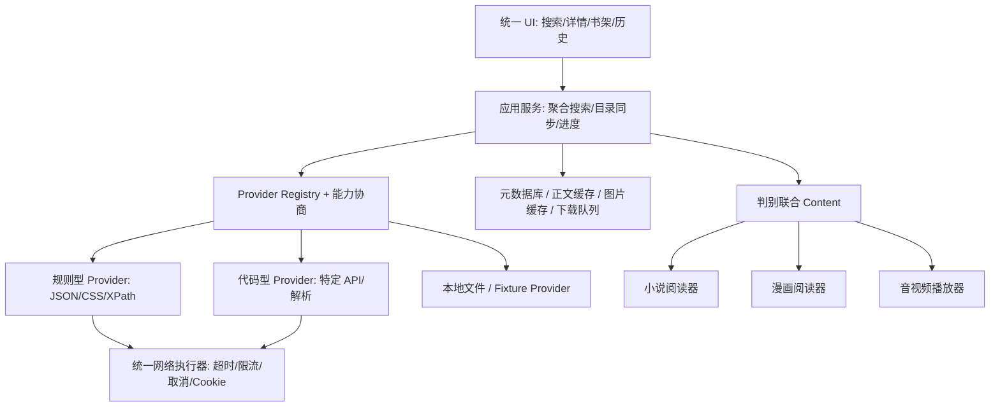

# 影视、小说、漫画聚合项目：开发交接与实施方案

日期：2026-10-18。用途：交给另一个开发 AI，基于源码理解三种设计，并实施可控、可验证的学习项目。

## 1. 结论与证据边界

建议以 **fqapp 的多媒体分发方式 + Legado 的规则适配思想 + Mihon 的漫画加载/离线状态机** 组合设计。三者不是一个可直接拼装的 SDK，也不应把第三方协议代码放进公共 UI 层。

| 项目 | 本次固定版本 | 最值得借鉴 | 必须认识的边界 |
|---|---|---|---|
| ch6vip/fqapp | `9ada894abac9cc94fded76958c1c71dbf479a754` | Flutter/Rust 分层、多媒体入口、读取分发、缓存和进度 | 默认 FFI；具体上游协议可能变化，不是通用开放内容 API |
| Legado 历史快照 | `CCSSNE/legado@da17bb2bed44f30b12a524c2457e32a20b16fa41` | URL 构造、规则解析、目录/正文分页、书源隔离 | 官方当前仓库已移除源码；此处为公开历史快照；实际请求取决于外部书源 |
| mihonapp/mihon | `deeb9b2584b6e246135cbd31da49a39e6b6e1e52` | Source 契约、章节同步、图片两步解析、预取、离线下载 | 具体站点协议在扩展中；核心没有统一漫画站搜索 API |

事实分级如下，后续 AI 需保持这个区别：

- **源码已确认**：本报告附固定提交的文件/行号链接，已读取相关实现。
- **本地演示已验证**：见 `evidence/verification.json`，仅对应随包演示服务。
- **建议设计**：下文数据契约、模块布局、错误码和开发阶段，是新项目方案，并非声称原仓库逐字实现。
- **未验证**：三个原客户端构建、Android 运行、外部书源与扩展导入、第三方实时接口、真实视频播放器解码、账号与会员内容。

开源让客户端内部逻辑可检查，并不意味着所有上游数据、媒体授权、服务端规则和插件都随源码开放。新项目应先用本地或已授权内容贯通完整流程。

## 2. 推荐架构



公共层只理解规范化结果。provider 负责远端 URL、请求头、会话和响应解析；网络层执行请求；展示层不保存私有上游结构。规则型与代码型 provider 使用同一上层契约，但不强迫复杂协议都塞进 JSON 规则。

如果学习项目采用 Web 前端，存在浏览器 CORS、Referer 禁止修改、Cookie 与来源隔离等限制。可使用仅面向受控 provider 的本地/后端执行器，不要设计任意 URL 的无约束开放代理。FFI、Android 原生扩展、WebView 三种运行模型各不相同，需要按目标平台实现 transport。

## 3. 核心数据契约（建议）

```ts
type MediaKind = 'novel' | 'manga' | 'video' | 'audio';
type ItemKey = { providerId: string; remoteId: string };
type ChapterKey = { item: ItemKey; remoteId: string };
type Cursor = { opaque: string }; // provider 自己解释，不统一假设 page=1
type ProviderCapabilities = {
  kinds: MediaKind[];
  search: boolean; browse: boolean; pagination: 'page'|'offset'|'cursor'|'none';
  authentication: 'none'|'optional'|'required'; offlineAllowed: boolean;
};
type MediaItem = {
  key: ItemKey; kind: MediaKind; title: string; authors: string[];
  cover?: Resource; description?: string; tags: string[]; status?: string;
  canonicalUrl?: string; updatedAt?: string;
};
type Chapter = {
  key: ChapterKey; title: string; order: number;
  displayNumber?: string; volume?: string; uploadedAt?: string;
  access: 'available'|'login'|'subscription'|'unknown';
};
type Resource = {
  url: string; headers?: Record<string,string>; expiresAt?: string;
  mime?: string; byteLength?: number; cachePolicy?: string;
};
type Content =
  | { kind:'text'; blocks: {id:string; text:string}[] }
  | { kind:'images'; pages: {index:number; image?:Resource; resolverId?:string}[] }
  | { kind:'video'; variants: {id:string; label:string; resource:Resource;
      format:'mp4'|'hls'|'dash'; codec?:string}[]; subtitles?:Resource[] }
  | { kind:'audio'; resource:Resource; voiceId?:string; transcript?:string }
  | { kind:'external'; url:string; reason:string };
interface Provider {
  id: string; version: string; capabilities: ProviderCapabilities;
  search(query:string, cursor?:Cursor, signal?:AbortSignal): Promise<{
    items:MediaItem[]; next?:Cursor; warnings?:string[]
  }>;
  detail(item:ItemKey, signal?:AbortSignal): Promise<MediaItem>;
  chapters(item:ItemKey, cursor?:Cursor, signal?:AbortSignal): Promise<{
    chapters:Chapter[]; next?:Cursor
  }>;
  content(chapter:ChapterKey, signal?:AbortSignal): Promise<Content>;
  resolveResource?(resolverId:string, signal?:AbortSignal): Promise<Resource>;
}
```

这是实现起点，不是现成可导入三仓库的类型文件。需要根据项目语言转换；分页 token 要与 query、filters、providerVersion 绑定，避免跨查询误用。资源过期、刷新 token、CookieJar 等属于 provider session，凭据不放进 MediaItem 或日志。

## 4. 标识、目录与去重

数据库应至少分成 providers、items、chapters、progress、library、download_jobs、cache_entries。远端自然键与本地数据库 ID 分开存储。建议唯一约束：

```text
items       UNIQUE(provider_id, remote_id)
chapters    UNIQUE(item_id, remote_id)
progress    UNIQUE(profile_id, item_id, media_kind)
cache       UNIQUE(provider_id, provider_version, item_remote_id,
                   chapter_remote_id, variant_or_voice, resource_kind)
```

同名内容跨平台可能是不同版本、翻译、卷或扫描组。搜索 UI 可展示候选聚类，但不要据书名自动将章节和阅读进度混在一起。fqapp 的 series/video/vid 不同，Legado 的 book/toc/chapter URL 不同，Mihon 的 source/manga/chapter/page 不同，均说明必须保留标识语义。[F15](https://github.com/ch6vip/fqapp/blob/9ada894abac9cc94fded76958c1c71dbf479a754/lib/models/media_item.dart#L15-L92) [F19](https://github.com/ch6vip/fqapp/blob/9ada894abac9cc94fded76958c1c71dbf479a754/rust/src/endpoints/router.rs#L316-L440) [L06](https://github.com/CCSSNE/legado/blob/da17bb2bed44f30b12a524c2457e32a20b16fa41/app/src/main/java/io/legado/app/data/entities/BookSource.kt#L31-L98) [L09](https://github.com/CCSSNE/legado/blob/da17bb2bed44f30b12a524c2457e32a20b16fa41/app/src/main/java/io/legado/app/model/webBook/BookChapterList.kt#L30-L135) [M10](https://github.com/mihonapp/mihon/blob/deeb9b2584b6e246135cbd31da49a39e6b6e1e52/app/src/main/java/eu/kanade/domain/chapter/interactor/SyncChaptersWithSource.kt#L52-L120)

目录刷新采用 upsert 与差异同步，保持用户已读和下载状态。顺序字段是展示排序，远端 ID 才承担关联；目录删除可标记不可用，不应立即删除用户下载。

## 5. 四种读取流程

### 小说

`search → detail → chapters → content(text) → 段落/章节渲染 → 进度`。正文分页先在 provider 中合并，再返回标准化 blocks；必须区分下一正文页与下一章，并有循环检测、最大页数和体积限制。缓存正文不应保存每台设备的最终分页结果；字体与视口变化后重新布局。可参考 Legado 的分页处理和 fqapp 的正文有效性检查。[L10](https://github.com/CCSSNE/legado/blob/da17bb2bed44f30b12a524c2457e32a20b16fa41/app/src/main/java/io/legado/app/model/webBook/BookContent.kt#L35-L155) [F07](https://github.com/ch6vip/fqapp/blob/9ada894abac9cc94fded76958c1c71dbf479a754/lib/services/api_client.dart#L1091-L1171)

### 漫画

`search → detail → chapters → content(images) → 按需 resolveResource → 下载/解码图片 → 定位恢复`。图片列表和最终 URL 允许分阶段获取；请求头需要一直保留到实际资源请求。采用 Mihon 的页状态与当前页优先窗口；切章后取消旧任务，显示层额外检查 generation。[M06](https://github.com/mihonapp/mihon/blob/deeb9b2584b6e246135cbd31da49a39e6b6e1e52/source-api/src/main/kotlin/eu/kanade/tachiyomi/source/online/HttpSource.kt#L365-L420) [M12](https://github.com/mihonapp/mihon/blob/deeb9b2584b6e246135cbd31da49a39e6b6e1e52/app/src/main/java/eu/kanade/tachiyomi/ui/reader/loader/HttpPageLoader.kt#L43-L103) [M13](https://github.com/mihonapp/mihon/blob/deeb9b2584b6e246135cbd31da49a39e6b6e1e52/app/src/main/java/eu/kanade/tachiyomi/ui/reader/loader/HttpPageLoader.kt#L140-L258) [F14](https://github.com/ch6vip/fqapp/blob/9ada894abac9cc94fded76958c1c71dbf479a754/lib/pages/comic_reader_page.dart#L150-L210)

### 视频

`search → series detail → episode list → content(video) → 选择 variant → 播放 → positionMs`。解析成功与播放成功分开统计。播放前后关注 MIME、封装/编码、URL 有效期、headers、Range/seek、字幕和清晰度切换。HLS/DASH 清单中的相对分片 URL 要按清单地址解析，资源代理必须保留必要头与 Range 语义。这里是新项目播放器设计要求，不表示本文运行验证过 fqapp 的所有格式。

### 音频

`search → book detail → chapters → content(audio, voiceId) → 播放 → positionMs`。音色影响播放资源和缓存键；字幕/文本不能当成音频地址。fqapp 的听书兼容文本桥接与真实播放接口分离是有用反例。[F22](https://github.com/ch6vip/fqapp/blob/9ada894abac9cc94fded76958c1c71dbf479a754/lib/services/api_client.dart#L377-L435)

## 6. 聚合搜索、请求调度与错误

聚合搜索应按 provider 逐个发回成功结果，不等待最慢源完成再全屏刷新。新 query 建立 generation、取消旧 query；各源的分页状态独立保存。全局并发、每 provider 并发和每 host 速率为三个不同限制。

对相同 GET 可进行共享请求，但共享结果与共享取消要分开：取消某个订阅者不能无条件终止其他订阅者。为一组 fallback 设总 deadline，不能每次换地址都重新计时。请求超时、媒体流读取超时和整个下载任务超时也不同。[F01](https://github.com/ch6vip/fqapp/blob/9ada894abac9cc94fded76958c1c71dbf479a754/lib/services/api_client.dart#L46-L210) [F11](https://github.com/ch6vip/fqapp/blob/9ada894abac9cc94fded76958c1c71dbf479a754/lib/services/request_gate.dart#L23-L91) [M18](https://github.com/mihonapp/mihon/blob/deeb9b2584b6e246135cbd31da49a39e6b6e1e52/app/src/main/java/eu/kanade/tachiyomi/ui/browse/source/globalsearch/SearchViewModel.kt#L130-L195)

建议错误码：`NetworkError/Timeout/Cancelled/AuthRequired/SubscriptionRequired/NotFound/ParseError/RateLimited/Unsupported/CacheError`。错误信息带 provider、阶段与 requestId，但过滤 Cookie、Authorization、token、会话 capability 和敏感查询值。空列表只能代表一次成功的“无结果”，不能承担所有错误。

仅对可安全重试的请求使用指数退避和抖动；尊重 Retry-After；GET 的解析失败不应通过连续重试掩盖规则过期。写操作不在默认重试队列内。图片返回 HTML、正文返回登录页、JSON business code 失败均应识别为错误。

## 7. 缓存、下载与进度

| 层 | 建议键和生命周期 | 注意点 |
|---|---|---|
| 元数据/目录 | provider+item+版本，短 TTL/显式刷新 | 目录刷新保留已读状态 |
| 正文 | provider+chapter+规则版本 | UTF-8 文本/blocks，失败不缓存为空正文 |
| 漫画页表 | provider+chapter+版本 | 允许过期图片 URL 重新解析 |
| 图片文件 | 资源稳定身份+内容版本 | 检查响应类型/解码，不缓存错误页为图片 |
| 媒体资源 | variant/voice+稳定内容身份 | 临时签名 URL 与内容身份分开 |
| 用户下载 | 下载 manifest + 文件校验 | 临时目录完成后原子转正，自动淘汰不删 pinned 内容 |
| 进度 | profile+item+类型 | 小说段落位置；漫画页+页内偏移；音视频 chapter+positionMs |

下载任务应持久化 queued/running/paused/failed/completed/cancelled，支持进程恢复；Range 续传先核对服务端响应，完成后校验长度/摘要。在线阅读可继续，但缓存落盘失败要能被观测，不能误报“已离线保存”。[F12](https://github.com/ch6vip/fqapp/blob/9ada894abac9cc94fded76958c1c71dbf479a754/lib/services/chapter_cache_store.dart#L114-L159) [F13](https://github.com/ch6vip/fqapp/blob/9ada894abac9cc94fded76958c1c71dbf479a754/lib/services/chapter_download.dart#L46-L163) [F23](https://github.com/ch6vip/fqapp/blob/9ada894abac9cc94fded76958c1c71dbf479a754/lib/services/chapter_download.dart#L183-L240) [M14](https://github.com/mihonapp/mihon/blob/deeb9b2584b6e246135cbd31da49a39e6b6e1e52/app/src/main/java/eu/kanade/tachiyomi/data/download/Downloader.kt#L412-L509) [M15](https://github.com/mihonapp/mihon/blob/deeb9b2584b6e246135cbd31da49a39e6b6e1e52/app/src/main/java/eu/kanade/tachiyomi/data/download/Downloader.kt#L576-L612)

## 8. 最小模块布局

```text
src/
  domain/         # MediaItem/Chapter/Content/Progress/Provider 契约
  providers/      # fixture、规则型和代码型 provider
  transport/      # HTTP、Cookie、限流、取消、资源读取
  application/    # 聚合搜索、目录同步、内容加载、下载任务
  storage/        # 元数据 DB、缓存索引、文件、迁移
  readers/        # novel、manga
  players/        # video、audio
  ui/             # 搜索、详情、书架、历史、设置
  observability/  # requestId、阶段耗时、脱敏诊断
```

不要建立一个数千行同时处理 UI、站点 URL、解析、缓存和播放器的万能 service。provider 测试应使用固定响应 fixture，网络执行器使用本地服务验证；阅读器与播放器可以消费同一标准 Content，不依赖网络是否在线。

## 9. 本包可运行演示与真实上游的区别

`examples/mock_provider.py` 是为本次交接编写的标准库演示，**并非从三个项目复制出的服务端**。它提供小说、漫画、视频、音频四种元数据/章节/内容描述；正文、生成 PNG 和生成 WAV 可实际请求；视频需要用户提供自己的 `examples/assets/sample.mp4`，未附加视频素材，因此默认视频响应会明确 `available=false`。

```powershell
cd "C:\Users\耿\OneDrive\文档\ChatGPT\temp\opensource-aggregation-study-2026-10-18"
python .\examples\mock_provider.py --port 8765
# 另一个终端或浏览器：
# http://127.0.0.1:8765/v1/search?kind=novel&query=&page=1&pageSize=10
# Ctrl+C 结束演示服务
```

同目录运行 `python .\examples\verify_demo.py` 可自动启动临时端口、校验链条并关闭服务，不留下后台进程。协议与请求示例见 `examples/README.md`。它是第一个实现 provider、UI 和测试的可控起点，不可拿演示测试通过推导第三方服务可用。

## 10. 给接手 AI 的执行顺序与验收

1. 先识别现有项目语言和结构，落地 domain/provider 契约与 FixtureProvider，不急着移植三仓库代码。
2. 接本包 mock：搜索→详情→目录→正文/图片。支持分页、取消、空结果和有类型错误；目录 key 稳定。
3. 实现小说阅读、漫画阅读、收藏和进度；刷新页面/重启后恢复；切章慢响应不能覆盖新章。
4. 接入 WAV 音频；用户提供自有 MP4 后验证视频播放、seek、位置恢复。未提供视频资产时显示明确状态。
5. 实现缓存与离线下载：断网能读已下载章节；半文件不作为完成；手动下载不会被普通缓存清理。
6. 实现规则子集，以本包 Legado 风格样例测试搜索、详情、目录、正文；若不支持某条语法则显式报错。
7. 再选一个明确授权的数据源或自建服务，实现真实 provider。固定文档/响应样本与版本，再做真实请求测试。
8. 如确有需要，再加入第三方可执行扩展；先完成签名、版本、权限、资源预算和崩溃隔离。

验收至少覆盖：分页不重复漏项；同名多源不会误合并；目录变化不清已读；取消不污染界面；图片 Referer/头不丢；资源过期可刷新；缓存写失败可见；下载暂停恢复与原子完成；日志不泄露凭据。实现阶段只运行与改动有关的检查，不必为阅读文档构建三套原应用。

## 11. 许可证和可维护性

fqapp 与此 Legado 快照根许可证为 GPL-3.0，Mihon 为 Apache-2.0。引用架构思想和直接复制代码是不同事情；如复制、修改并分发代码，应核查对应许可证、版权声明、依赖和扩展自身许可。根许可证不自动覆盖第三方上游内容使用权。

保存 provider 版本、规则摘要、解析样例和失效原因。线上接口变化时更新 provider，不让 UI 追着站点字段改。将授权要求、已知限制、支持格式、分页语义和维护状态列入 provider 元信息，后续 AI 才能判断是页面问题还是适配器失效。
