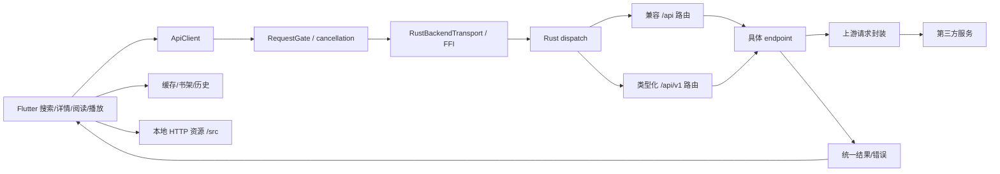

# fqapp：多媒体分发、请求链与本地状态

分析版本：`ch6vip/fqapp@9ada894abac9cc94fded76958c1c71dbf479a754`。以下是此提交的静态源码事实，未运行客户端或验证第三方在线接口。项目根目录许可证为 GPL-3.0；复制实现前应核对完整许可证及依赖许可。

## 1. 架构和边界

这三个项目中，fqapp 最适合参考小说、漫画、短剧、漫剧、听书共同入口的组织方式。Flutter 负责页面、统一模型、阅读器与播放器状态；Rust 负责业务分发、第三方协议和资源服务。默认业务请求通过 flutter_rust_bridge 进入 Rust dispatcher；虽然参数长得像 HTTP method/path/query，**默认链路并非每次都向 127.0.0.1 发 HTTP JSON 请求**。`HttpBackendTransport` 是另一种传输实现，注入 HTTP client/baseUrl 时会使用它。[F01](https://github.com/ch6vip/fqapp/blob/9ada894abac9cc94fded76958c1c71dbf479a754/lib/services/api_client.dart#L46-L210) [F17](https://github.com/ch6vip/fqapp/blob/9ada894abac9cc94fded76958c1c71dbf479a754/lib/services/backend_transport.dart#L117-L300)



必须区分三类地址：

| 类型 | 示例 | 用途 |
|---|---|---|
| 逻辑业务路由 | `/api/search`、`/api/v1/chapters/{id}/novel` | Flutter 与 Rust 的方法协议，默认 FFI |
| 本地资源 URL | `http://127.0.0.1:{port}/_session/{capability}/src/...` | 图片、媒体等需要真实 URL 的资源；端口与 capability 按运行时获取 |
| 第三方上游 URL | `https://api.fanqiesdk.com/...` | Rust 发出的实际网络请求；与前两者不是同一层 |

运行时资源基址带会话 capability，拼接 `/src/...` 时必须保留前缀。服务端检查 Host、Origin 和会话访问条件，不能把示例 localhost 当成可公开暴露的聚合服务器。业务 JSON 与资源请求也应分别观测。[F10](https://github.com/ch6vip/fqapp/blob/9ada894abac9cc94fded76958c1c71dbf479a754/rust/src/server.rs#L82-L172) [F17](https://github.com/ch6vip/fqapp/blob/9ada894abac9cc94fded76958c1c71dbf479a754/lib/services/backend_transport.dart#L117-L300) [F25](https://github.com/ch6vip/fqapp/blob/9ada894abac9cc94fded76958c1c71dbf479a754/lib/services/backend_service.dart#L1-L326)

## 2. 搜索完整链

入口：搜索页面 → `ApiClient` → `_get` → `RequestGate` → transport → Rust `dispatch` → endpoint → 解析结果 → `MediaItem` → UI。

`MediaItem` 收拢 `id/title/cover/author/badge/ep/kind`，另有可选的评分、标签、剧集 ID、单集 ID、简介、关注数、分类等。`id`、`seriesId`、`episodeId` 不应合并成一个无语义 ID。后续请求必须取对应媒体类型所需标识。[F15](https://github.com/ch6vip/fqapp/blob/9ada894abac9cc94fded76958c1c71dbf479a754/lib/models/media_item.dart#L15-L92)

有两条搜索路径，分页规则不同：

| 入口 | 逻辑请求 | 参数语义 | Rust 处理 |
|---|---|---|---|
| 兼容搜索 | `GET /api/search?source=番茄&query={keyword}&page={page}` | page 为页面分页 | WebUI 层换算 offset=`(page-1)*9` |
| 标签搜索 | `GET /api/v1/search?query={keyword}&tab_type={tabType}&offset={offset}&count=10` | 显式 offset；默认从 page 换算为 `(page-1)*10` | 类型化搜索 endpoint |

不能把这两条路径的页大小统一写死为同一数值。`source=番茄` 是兼容协议的 source 值，不代表已实现任意站点书源插件。[F02](https://github.com/ch6vip/fqapp/blob/9ada894abac9cc94fded76958c1c71dbf479a754/lib/services/api_client.dart#L233-L343) [F03](https://github.com/ch6vip/fqapp/blob/9ada894abac9cc94fded76958c1c71dbf479a754/rust/src/endpoints/webui.rs#L47-L169) [F04](https://github.com/ch6vip/fqapp/blob/9ada894abac9cc94fded76958c1c71dbf479a754/rust/src/endpoints/search.rs#L34-L106)

源码可确认的上游形状：

| 函数 | 上游地址 | 核心业务参数 |
|---|---|---|
| `search_fanqie` | `https://api.fanqiesdk.com/api/novel/channel/homepage/search/search/v1/` | `q`、`offset`，使用签名请求模式 |
| `search_reading` | `https://api5-normal-sinfonlineb.fqnovel.com/reading/bookapi/search/tab/v` | `query`、`offset`、`count`、`tab_type`、`passback` |

这些是代码中的目标地址与参数构造证据，**不是只带以上参数即可匿名调用的公开 API 文档**。真实发送还通过上游 client 处理设备、请求头和协议要求。新聚合器应把此类逻辑封装为 provider 的鉴权/会话能力，不在公共层硬编码设备数据。本文不提供签名密钥、受保护媒体解密材料或付费授权替代方案。[F04](https://github.com/ch6vip/fqapp/blob/9ada894abac9cc94fded76958c1c71dbf479a754/rust/src/endpoints/search.rs#L34-L106) [F16](https://github.com/ch6vip/fqapp/blob/9ada894abac9cc94fded76958c1c71dbf479a754/rust/src/upstream/client.rs#L122-L278)

`normalize_search_tabs` 会在兼容数据缺失分类时，把综合结果填入部分空标签。因此“某标签出现结果”不必然等于上游已准确按类型筛选。新的聚合器应显式记录 `mediaKind` 和类型判定来源，不能只依赖 UI 标签文字。[F03](https://github.com/ch6vip/fqapp/blob/9ada894abac9cc94fded76958c1c71dbf479a754/rust/src/endpoints/webui.rs#L47-L169)

## 3. 详情、目录与媒体 ID

| 操作 | 逻辑请求 | 注意点 |
|---|---|---|
| 详情 | `/api/detail?source=番茄&book_id={bookId}&tab={tab}` | tab 参与分发；听书详情有独立处理 |
| 目录 | `/api/directory?source=番茄&book_id={bookId}&tab={tab}` | 短剧目录可走后备 series 路径 |
| 单书详情 | `/api/v1/books/{bookId}/detail` | 路由映射至具体 endpoint |
| 单书目录 | `/api/v1/books/{bookId}/directory` | 与渲染页面解耦 |
| 剧集详情 | `/api/v1/series/{seriesId}` | 映射到 `video_detail` |
| 关联剧集 | `/api/v1/series/{seriesId}/related` | 可独立加载和失败 |

兼容目录的短剧分支先尝试 directory，失败或找不到有效集数时再尝试 pseries，并将返回结构转换成 UI 所需目录。新实现应记录 fallback 发生原因，否则“空目录”和“网络失败后回退”容易被混淆。`SeriesDetailPage` 将详情、集数、评论等任务拆开加载；评论失败不应使可播放的集数消失。[F02](https://github.com/ch6vip/fqapp/blob/9ada894abac9cc94fded76958c1c71dbf479a754/lib/services/api_client.dart#L233-L343) [F05](https://github.com/ch6vip/fqapp/blob/9ada894abac9cc94fded76958c1c71dbf479a754/rust/src/endpoints/webui.rs#L171-L232) [F19](https://github.com/ch6vip/fqapp/blob/9ada894abac9cc94fded76958c1c71dbf479a754/rust/src/endpoints/router.rs#L316-L440) [F20](https://github.com/ch6vip/fqapp/blob/9ada894abac9cc94fded76958c1c71dbf479a754/lib/pages/series_detail_page.dart#L150-L285)

一个可确认的目录上游为 `https://fanqienovel.com/api/reader/directory/detail?`。完整 endpoint 还会追加参数和处理返回结构；不能将所有媒体目录都简化为此 URL。[F24](https://github.com/ch6vip/fqapp/blob/9ada894abac9cc94fded76958c1c71dbf479a754/rust/src/endpoints/book.rs#L98-L210)

另一个需要特别指出的命名陷阱：`/api/v1/videos/{id}/detail` 在此路由中把 `{id}` 写入 `series_id`；普通 `/api/v1/videos/{id}` 则写入 `video_id`。弹幕读取使用 `vid`。不要从 REST 名称自行猜 ID 类型，应检查实际 router。[F19](https://github.com/ch6vip/fqapp/blob/9ada894abac9cc94fded76958c1c71dbf479a754/rust/src/endpoints/router.rs#L316-L440)

## 4. 小说正文链

```text
目录 Chapter.itemId
  → ApiClient.chapterContent(itemId)
  → GET /api/v1/chapters/{itemId}/novel（逻辑调用）
  → Rust content endpoint / provider 协议处理
  → 检查 data.content_decrypted == true 且 content 为字符串
  → 正文块解析
  → 阅读器布局、渲染与本地进度
```

主路径失败时可退回 `contentText` 兼容入口：`/api/content?source=番茄&item_id={itemId}&tab=小说`。fallback 使用剩余超时预算，并非每次重给完整超时；正文不满足可读条件时应报错，不能把未解码的数据当作文本展示。`Isolate.run` 用于将部分解码/解析工作移出 UI isolate。[F06](https://github.com/ch6vip/fqapp/blob/9ada894abac9cc94fded76958c1c71dbf479a754/rust/src/endpoints/webui.rs#L371-L420) [F07](https://github.com/ch6vip/fqapp/blob/9ada894abac9cc94fded76958c1c71dbf479a754/lib/services/api_client.dart#L1091-L1171)

对新项目而言，应统一返回 `TextContent { blocks, plainText?, sourceUrl?, fetchedAt }`，由 provider 保证输出是正常可读正文；公共阅读器只负责排版、字体、分页、主题、选区和进度。不要让阅读器知道上游的私有响应结构。

## 5. 漫画图片链

```text
目录 chapter.itemId
  → ComicReaderPage._loadChapter
  → ApiClient.comicImages(itemId)
  → /api/content?...&tab=漫画
  → Rust manga endpoint（item_ids）
  → parseComicImages(payload, resourceBase)
  → 有序图片资源
  → 图片加载、滚动阅读、定位恢复
```

漫画请求单独允许较长超时（90 秒）。页面切章建立新的 generation，并通过取消上下文发请求；返回时再次检查 generation/mounted，避免 A 章慢响应覆盖已经切到的 B 章。仅有请求取消还不够，显示层仍需检查结果所属 generation。资源 URL 必须正确解析相对路径和 capability 基址。[F07](https://github.com/ch6vip/fqapp/blob/9ada894abac9cc94fded76958c1c71dbf479a754/lib/services/api_client.dart#L1091-L1171) [F14](https://github.com/ch6vip/fqapp/blob/9ada894abac9cc94fded76958c1c71dbf479a754/lib/pages/comic_reader_page.dart#L150-L210)

建议漫画进度使用“chapter key + image index + 图片内相对位置”，不要只存跨设备不稳定的绝对滚动像素。此条是面向新项目的设计建议；不是对每个缓存字段的逐项运行验证。

## 6. 听书链

通用 `/api/content?...&tab=听书` 会走 `wkcontent`，该 speech-text bridge 不能替代可播放音频接口。`ApiClient.audioSource` 明确要求 `bookId`，实际使用：

```text
/api/v1/audio/books/{bookId}/chapters/{chapterId}?tone_id={toneId}
```

默认 tone 为 `0`；上游对特定音色返回业务失败时不能默默用字幕结果伪装成音频成功。`parsePlayinfoSource` 优先处理播放信息，只有符合限定的解析失败才退回另一种音频结构。新模型至少保留 `bookId/chapterId/toneId/url/requestHeaders/expiry?`，切换音色也必须改变缓存键。[F22](https://github.com/ch6vip/fqapp/blob/9ada894abac9cc94fded76958c1c71dbf479a754/lib/services/api_client.dart#L377-L435)

## 7. 短剧、漫剧与播放链

```text
搜索 MediaItem（seriesId / episodeId 分开）
  → seriesDetail / episodes
  → 用户选择 episode
  → /api/v1/videos/{videoId} 或兼容 content 分支
  → video endpoint 解析上游模型/候选资源
  → 视频源与格式选择
  → 播放器请求资源
  → 播放位置/已看集状态
```

兼容 `/api/content` 的 `tab=短剧|漫剧` 进入 video 分支，传 `video_id/item_ids/mode`。`video.rs` 会读取视频模型，尝试候选源及后备信息，最后才退回通用 URL 提取。某些路径包含特定上游加密协议处理，它们不是一个通用、稳定、无授权要求的公开视频 API。为新聚合器实现播放器时，先用自有 MP4/HLS 或有明确授权的内容；provider 返回可播放 URL、格式、清晰度、必要请求头和过期信息。[F06](https://github.com/ch6vip/fqapp/blob/9ada894abac9cc94fded76958c1c71dbf479a754/rust/src/endpoints/webui.rs#L371-L420) [F19](https://github.com/ch6vip/fqapp/blob/9ada894abac9cc94fded76958c1c71dbf479a754/rust/src/endpoints/router.rs#L316-L440) [F21](https://github.com/ch6vip/fqapp/blob/9ada894abac9cc94fded76958c1c71dbf479a754/rust/src/endpoints/video.rs#L247-L404)

不要将 `seriesId` 当成播放 URL，也不要把“拿到 JSON”当成已经成功播放。播放验证至少包含：资源实际可取、Content-Type/格式可识别、播放器解码支持、时长能读取、seek 可用，以及请求头是否从解析层正确传到资源层。

## 8. 请求并发、错误与取消

`RequestGate` 默认最大并发 16，FIFO 排队，对相同 GET URL+timeout 的请求共享结果；带 body 的调用不按这一规则合并。合并请求的加入方取消，不应直接取消所有人的 owner；owner 取消时，加入方有独立恢复逻辑。不要把“全局去重”和“全局共享取消令牌”写成同一个概念。[F11](https://github.com/ch6vip/fqapp/blob/9ada894abac9cc94fded76958c1c71dbf479a754/lib/services/request_gate.dart#L23-L91)

`ApiClient` 将 HTTP 状态与业务 envelope 分开检查。界面日志使用路由模板等信息，避免把完整敏感 query 直接落盘。新项目应把错误分类为网络、超时、取消、鉴权、解析、内容不存在、协议不支持、缓存失败，而不是一律返回空列表。[F01](https://github.com/ch6vip/fqapp/blob/9ada894abac9cc94fded76958c1c71dbf479a754/lib/services/api_client.dart#L46-L210)

## 9. 缓存、下载、历史

| 部件 | 关键行为 | 借鉴方式 |
|---|---|---|
| `ChapterCacheStore` | 默认 500 条、80 MiB，目录 TTL 30 天；加密 Hive 初始化有失败处理 | 缓存命中与有效性单独建模；密钥失败不应破坏历史文件 |
| 单章/批量下载 | 优先缓存，逐章加载，支持进度和取消；内容回调可早于缓存持久化 | 在线可读与持久化成功分别报告 |
| 全书下载管理 | 使用全局任务管理器，任务不依赖详情页存活；显式下载可 pin | 页面取消与用户下载任务取消分开 |
| `LibraryStore` | 书架、历史、阅读时长、已看集等本地状态；写操作串行化 | 多个媒体使用独立进度结构，统一书架入口 |

自动缓存预算与用户明确保存的下载内容不是同一种淘汰对象。目录、正文、图片、媒体文件的 TTL 和容量也不应只用一个数字控制。[F12](https://github.com/ch6vip/fqapp/blob/9ada894abac9cc94fded76958c1c71dbf479a754/lib/services/chapter_cache_store.dart#L114-L159) [F13](https://github.com/ch6vip/fqapp/blob/9ada894abac9cc94fded76958c1c71dbf479a754/lib/services/chapter_download.dart#L46-L163) [F18](https://github.com/ch6vip/fqapp/blob/9ada894abac9cc94fded76958c1c71dbf479a754/lib/services/library_store.dart#L81-L149) [F23](https://github.com/ch6vip/fqapp/blob/9ada894abac9cc94fded76958c1c71dbf479a754/lib/services/chapter_download.dart#L183-L240)

## 10. 对聚合项目最有用的结论

复用思路的优先顺序是：多媒体入口与统一模型 → transport/provider 分层 → 按类型分发内容 → 请求取消/去重 → 独立阅读和播放引擎 → 缓存、下载和进度。第三方协议只应放在 provider 内；业务路由可参考，但不应直接把这些 localhost 路由当成外部公共接口。

此报告覆盖代表性的读取链、缓存与状态边界；没有验证每个评论、账号、推荐或写接口，也没有证明这些第三方地址在分析日仍能成功返回完整内容。

## 11. 关键上游地址与调用定位补表

这是源码中的协议地图，用于定位已有实现。仅列业务字段和目标地址，通用参数、会话、协议校验由 provider 的 upstream client 处理；未对外部服务发送这些请求。不要将路径常量误当成已经验证可用的公开 API。

| 阶段 | 上游方法/地址形状 | 业务字段与触发条件 | 证据 |
|---|---|---|---|
| 兼容书籍详情 | GET `https://api5-normal-sinfonlineb.fqnovel.com/reading/bookapi/detail/v` | `book_id`；兼容 detail 分支 | [F27](https://github.com/ch6vip/fqapp/blob/9ada894abac9cc94fded76958c1c71dbf479a754/rust/src/endpoints/book.rs#L65-L96) [F33](https://github.com/ch6vip/fqapp/blob/9ada894abac9cc94fded76958c1c71dbf479a754/rust/src/endpoints/base.rs#L11-L16) |
| 常规目录 | GET `https://api5-normal-sinfonlineb.fqnovel.com/reading/bookapi/directory/all_items/v` | `book_id`、目录摘要等；默认 directory 分支 | [F24](https://github.com/ch6vip/fqapp/blob/9ada894abac9cc94fded76958c1c71dbf479a754/rust/src/endpoints/book.rs#L98-L210) [F33](https://github.com/ch6vip/fqapp/blob/9ada894abac9cc94fded76958c1c71dbf479a754/rust/src/endpoints/base.rs#L11-L16) |
| 另一目录分支 | GET `https://novel.snssdk.com/api/novel/book/directory/list/v1/` | `book_id`；`api_type=novel` 分支，不能误写为所有目录默认路径 | [F24](https://github.com/ch6vip/fqapp/blob/9ada894abac9cc94fded76958c1c71dbf479a754/rust/src/endpoints/book.rs#L98-L210) [F33](https://github.com/ch6vip/fqapp/blob/9ada894abac9cc94fded76958c1c71dbf479a754/rust/src/endpoints/base.rs#L11-L16) |
| 小说类型化正文 | GET `https://novel.snssdk.com/api/novel/book/reader/content/v1` | `item_id`；router 令 `api_type=novel`，content 调用专用 reader handler | [F09](https://github.com/ch6vip/fqapp/blob/9ada894abac9cc94fded76958c1c71dbf479a754/rust/src/endpoints/router.rs#L23-L115) [F28](https://github.com/ch6vip/fqapp/blob/9ada894abac9cc94fded76958c1c71dbf479a754/rust/src/endpoints/content.rs#L178-L201) [F29](https://github.com/ch6vip/fqapp/blob/9ada894abac9cc94fded76958c1c71dbf479a754/rust/src/endpoints/dhcontent.rs#L11-L17) [F33](https://github.com/ch6vip/fqapp/blob/9ada894abac9cc94fded76958c1c71dbf479a754/rust/src/endpoints/base.rs#L11-L16) |
| 兼容单章/漫画正文 | GET `https://reading.snssdk.com/reading/reader/full/v/` | `item_id`；full 分支，返回内容仍需 provider 协议解析 | [F30](https://github.com/ch6vip/fqapp/blob/9ada894abac9cc94fded76958c1c71dbf479a754/rust/src/endpoints/manga.rs#L29-L49) |
| 批量正文路径 | GET `https://api5-normal-sinfonlineb.fqnovel.com/reading/reader/batch_full/v` | `item_ids` 等；不是主路径固定默认值 | [F30](https://github.com/ch6vip/fqapp/blob/9ada894abac9cc94fded76958c1c71dbf479a754/rust/src/endpoints/manga.rs#L29-L49) |
| 当前听书播放信息 | GET `https://api5-normal-sinfonlineb.fqnovel.com/reading/reader/audio/playinfo/` | `book_id`、`item_ids=chapterId`、`tone_id`、`req_type=0` 等 | [F31](https://github.com/ch6vip/fqapp/blob/9ada894abac9cc94fded76958c1c71dbf479a754/rust/src/endpoints/audio.rs#L86-L119) [F33](https://github.com/ch6vip/fqapp/blob/9ada894abac9cc94fded76958c1c71dbf479a754/rust/src/endpoints/base.rs#L11-L16) |
| 视频模型之一 | POST `https://api5-normal-sinfonlineb.fqnovel.com/novel/player/multi_video_model/v1/` | JSON 中 `mixed_video_id_map` 与业务选项；目标 URL 由公共函数构造 | [F32](https://github.com/ch6vip/fqapp/blob/9ada894abac9cc94fded76958c1c71dbf479a754/rust/src/endpoints/video.rs#L137-L195) [F34](https://github.com/ch6vip/fqapp/blob/9ada894abac9cc94fded76958c1c71dbf479a754/rust/src/endpoints/base.rs#L174-L179) |
| 短剧视频模型 | POST `https://api3-normal-sinfonlinea.fqnovel.com/novel/player/video_model/v1/` | JSON 中 `video_id`、`content_type`、`biz_param` | [F32](https://github.com/ch6vip/fqapp/blob/9ada894abac9cc94fded76958c1c71dbf479a754/rust/src/endpoints/video.rs#L137-L195) [F35](https://github.com/ch6vip/fqapp/blob/9ada894abac9cc94fded76958c1c71dbf479a754/rust/src/endpoints/video.rs#L36-L45) |

表中上游的单章/批量路径与小说 reader 路径是不同分支。尤其不能看到 `content.rs` 中第一个 URL 常量就断言“小说阅读全部调用 full/v”；应从 `ApiClient.chapterContent → typed router → content(api_type=novel)` 实际分发追踪。私有内容的编码、授权与播放资源解析继续留在 provider 内部，公共项目先使用本包 fixture 接通数据流。
