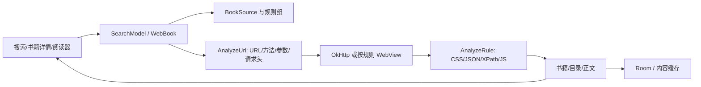

# Legado：书源规则、抓取流程与阅读缓存

来源必须先说清楚：2026-10-18 检查 `gedoor/legado` 时，官方 main 只剩公告与相关图片，没有可分析的完整应用源码。本报告使用公开保存的历史源码 `CCSSNE/legado@da17bb2bed44f30b12a524c2457e32a20b16fa41`。不能将其称为官方当前版本，也未独立证明它是原项目最终提交。快照信息与哈希见 `evidence/source-manifest.json`。根许可证为 GPL-3.0。

这是静态代码分析，未运行 Android 应用、导入书源或测试在线站点。书源规则是外部配置，客户端源码并不包含所有站点的实际请求地址。

## 1. 三层结构



`BookSource` 的主键是 `bookSourceUrl`；这个字段同时承担书源身份用途，不应仅当展示文字。它包含请求头、Cookie 开关、并发速率、登录相关字段、JS 库、搜索/发现 URL，以及 `ruleSearch/ruleExplore/ruleBookInfo/ruleToc/ruleContent/ruleReview`。`bookSourceType` 在本快照中为 0 文本、1 音频、2 图片、3 文件，没有通用影视枚举。适合借鉴小说与规则引擎，不应宣传为原生影视聚合内核。[L06](https://github.com/CCSSNE/legado/blob/da17bb2bed44f30b12a524c2457e32a20b16fa41/app/src/main/java/io/legado/app/data/entities/BookSource.kt#L31-L98)

## 2. 搜索：规则如何成为 HTTP 请求

```text
SearchModel 选择启用的书源
  → 每个书源 WebBook.searchBookAwait(source, key, page)
  → AnalyzeUrl(source.searchUrl, key, page, baseUrl=source.bookSourceUrl)
  → 解析模板/JS/URL options
  → getStrResponseAwait()
  → 可选 loginCheckJs、重定向处理
  → BookList.analyzeBookList(... ruleSearch)
  → 统一搜索结果 / 本地数据库 / UI
```

多书源聚合发生在 `SearchModel`；单书源协议由 `WebBook` 解释。将两层拆开之后，新增书源无需修改搜索页面。部分书源失败应能与其他书源成功同时呈现。[L01](https://github.com/CCSSNE/legado/blob/da17bb2bed44f30b12a524c2457e32a20b16fa41/app/src/main/java/io/legado/app/model/webBook/WebBook.kt#L34-L87) [L12](https://github.com/CCSSNE/legado/blob/da17bb2bed44f30b12a524c2457e32a20b16fa41/app/src/main/java/io/legado/app/model/webBook/SearchModel.kt#L47-L109)

`AnalyzeUrl` 并非简单的 `replace("{key}", keyword)`：

1. 执行支持的 JS 片段（例如 `@js:`、`<js>`）。
2. 处理 `{{...}}` 表达式和分页选择，`key/page` 可作为表达式环境变量。
3. 解析相对 URL，结合 baseUrl 得到绝对 URL。
4. 分离 URL 和 JSON options，读取 `method/headers/body/type/charset/retry/webView/webJs` 等字段。
5. GET 编码查询参数；POST 根据 body 与 Content-Type 分为 form、JSON、XML或其他正文。

因此，迁移到其他语言时不能只实现 CSS 选择器就声称兼容全部书源。URL 语法、JS 上下文、编码、Cookie 和 WebView 都会影响结果。[L04](https://github.com/CCSSNE/legado/blob/da17bb2bed44f30b12a524c2457e32a20b16fa41/app/src/main/java/io/legado/app/model/analyzeRule/AnalyzeUrl.kt#L140-L270)

请求层在并发速率限制范围内附加 Cookie。只有规则启用 WebView 且调用环境允许时，才进入后台 WebView 路径；`getStrResponseAwait` 的允许参数为 true 不代表所有请求都使用 WebView。普通 HTTP 路径使用 OkHttp。[L05](https://github.com/CCSSNE/legado/blob/da17bb2bed44f30b12a524c2457e32a20b16fa41/app/src/main/java/io/legado/app/model/analyzeRule/AnalyzeUrl.kt#L400-L532)

## 3. 规则字段与数据流

| 阶段 | 配置字段 | 输出 | 主要解析器 |
|---|---|---|---|
| 搜索列表 | `bookList/name/author/bookUrl/coverUrl/intro/...` | 搜索条目 | `BookList` |
| 详情 | `name/author/intro/kind/coverUrl/tocUrl/...` | 完整书籍元信息、目录入口 | `BookInfo` |
| 目录 | `chapterList/chapterName/chapterUrl/nextTocUrl/...` | 有序章节 | `BookChapterList` |
| 正文 | `content/title/nextContentUrl/replaceRegex/...` | 正文与章内下一页 | `BookContent` |

字段列表来自各 Rule 实体；具体提取要经过 AnalyzeRule。引擎可以切换 JS、JSON、XPath 和默认 Jsoup 等模式，规则链还有拼接与替换语义。新项目若实现兼容子集，必须在导入时告知不支持的字段，避免静默把规则当成空结果。[L18](https://github.com/CCSSNE/legado/blob/da17bb2bed44f30b12a524c2457e32a20b16fa41/app/src/main/java/io/legado/app/data/entities/rule/SearchRule.kt#L12-L25) [L19](https://github.com/CCSSNE/legado/blob/da17bb2bed44f30b12a524c2457e32a20b16fa41/app/src/main/java/io/legado/app/data/entities/rule/BookInfoRule.kt#L12-L25) [L16](https://github.com/CCSSNE/legado/blob/da17bb2bed44f30b12a524c2457e32a20b16fa41/app/src/main/java/io/legado/app/data/entities/rule/TocRule.kt#L8-L20) [L17](https://github.com/CCSSNE/legado/blob/da17bb2bed44f30b12a524c2457e32a20b16fa41/app/src/main/java/io/legado/app/data/entities/rule/ContentRule.kt#L12-L22) [L11](https://github.com/CCSSNE/legado/blob/da17bb2bed44f30b12a524c2457e32a20b16fa41/app/src/main/java/io/legado/app/model/analyzeRule/AnalyzeRule.kt#L163-L245) [L20](https://github.com/CCSSNE/legado/blob/da17bb2bed44f30b12a524c2457e32a20b16fa41/app/src/main/java/io/legado/app/model/analyzeRule/AnalyzeRule.kt#L532-L643)

搜索条目的 `bookUrl`、详情的 `tocUrl`、章节的 `chapterUrl` 和分页 URL 必须分别解析和保存。封面也可能是相对地址。不能以书名作为远端唯一键。[L07](https://github.com/CCSSNE/legado/blob/da17bb2bed44f30b12a524c2457e32a20b16fa41/app/src/main/java/io/legado/app/model/webBook/BookList.kt#L35-L160) [L08](https://github.com/CCSSNE/legado/blob/da17bb2bed44f30b12a524c2457e32a20b16fa41/app/src/main/java/io/legado/app/model/webBook/BookInfo.kt#L28-L162)

## 4. 详情与目录链

`WebBook.getBookInfoAwait` 可以复用已存的 `infoHtml`；没有可用 HTML 时请求 `book.bookUrl`，再将响应正文和最终重定向地址交给 `BookInfo`。因此一次详情渲染不一定对应一次网络请求。[L02](https://github.com/CCSSNE/legado/blob/da17bb2bed44f30b12a524c2457e32a20b16fa41/app/src/main/java/io/legado/app/model/webBook/WebBook.kt#L152-L269)

目录链：

```text
Book.tocUrl
  → 可选 preUpdateJs
  → 若详情页与目录页相同且已有 tocHtml，复用 HTML
  → 否则 AnalyzeUrl(tocUrl, baseUrl=book.bookUrl) 发请求
  → BookChapterList 抽取 chapterList
  → 对每一项取 name/url/volume/vip/pay 等字段
  → 跟随 nextTocUrl 合并后续目录页
  → 去重、方向处理、章节序号
```

目录为空有专门的异常处理；不能统一成“此书已经完结且无章节”。目录页的分页与章节正文内分页是两套独立循环，必须分别限次数、去重和处理取消。章节 `isVip/isPay` 是元数据，不等于正文已经可访问。[L02](https://github.com/CCSSNE/legado/blob/da17bb2bed44f30b12a524c2457e32a20b16fa41/app/src/main/java/io/legado/app/model/webBook/WebBook.kt#L152-L269) [L09](https://github.com/CCSSNE/legado/blob/da17bb2bed44f30b12a524c2457e32a20b16fa41/app/src/main/java/io/legado/app/model/webBook/BookChapterList.kt#L30-L135) [L16](https://github.com/CCSSNE/legado/blob/da17bb2bed44f30b12a524c2457e32a20b16fa41/app/src/main/java/io/legado/app/data/entities/rule/TocRule.kt#L8-L20)

## 5. 正文与章内分页链

```text
Book + Chapter
  → 若特殊目录项，处理卷标题等情况
  → 可复用目录/详情 HTML；否则请求 chapterUrl
  → 可选登录状态检查
  → BookContent.analyzeContent
  → 取 content/title
  → nextContentUrl 循环或并行取后续正文页
  → 防重复 URL，并防止误把下一章作为本章下一页
  → 合并、清理与替换
  → 保存内容（需要时）
  → 排版、阅读进度
```

`BookContent` 接受已知的下一章 URL，循环时会避免将它吞入当前正文；也会保存访问过的分页 URL。新引擎需同时设置最大页数与最大正文大小，防止错误规则无限跟页。多分页列表可以并发抓取，但展示顺序必须按原分页顺序合并。[L03](https://github.com/CCSSNE/legado/blob/da17bb2bed44f30b12a524c2457e32a20b16fa41/app/src/main/java/io/legado/app/model/webBook/WebBook.kt#L299-L355) [L10](https://github.com/CCSSNE/legado/blob/da17bb2bed44f30b12a524c2457e32a20b16fa41/app/src/main/java/io/legado/app/model/webBook/BookContent.kt#L35-L155)

另一个容易误判的分支：若没有正文 rule，`getContentAwait` 可直接返回章节 URL。它不是“已经获取正文”的证据。聚合器应对最终内容类型显式建模，例如 TextContent、ImagePages、ExternalLink，不依赖字符串非空判定成功。[L03](https://github.com/CCSSNE/legado/blob/da17bb2bed44f30b12a524c2457e32a20b16fa41/app/src/main/java/io/legado/app/model/webBook/WebBook.kt#L299-L355)

## 6. 缓存、预读与续读

`ReadBook.loadContent` 先查询章节记录，再用 `BookHelp.getContent` 尝试本地内容；未命中才下载。当前章与前后章预取在阅读状态中协调，预下载采用独立信号量。`addLoading/removeLoading` 避免同一章节重复进入加载。[L13](https://github.com/CCSSNE/legado/blob/da17bb2bed44f30b12a524c2457e32a20b16fa41/app/src/main/java/io/legado/app/model/ReadBook.kt#L534-L640)

新实现应拆分：

- 书架/书籍表：持久保存用户选择和来源。
- 章节表：目录序号、远端 URL、标题、更新时间、标记。
- 正文缓存：按 source+book+chapter+规则版本定位，命中后再做展示处理。
- 阅读进度：章 ID + 段落/字符位置；字号、宽度变化后重新排版。
- 用户下载：独立任务和持久化状态，不能随普通临时缓存清理。

以上表结构和版本键是面向新项目的建议，不是宣称原项目数据库字段逐字如此。

## 7. 应用本地 Web API 与站点 API 的区别

Legado 的 `api.md` 与 HttpServer 提供应用控制入口。需先在应用中开启 Web 服务；文档示例使用 HTTP 端口 1234，WebSocket 1235，实际以应用配置为准。不要把这些地址当成书源站点自己的 API。[L14](https://github.com/CCSSNE/legado/blob/da17bb2bed44f30b12a524c2457e32a20b16fa41/app/src/main/java/io/legado/app/web/HttpServer.kt#L25-L112) [L21](https://github.com/CCSSNE/legado/blob/da17bb2bed44f30b12a524c2457e32a20b16fa41/api.md#L1-L293)

| 本地控制操作 | 请求形状 | 语义 |
|---|---|---|
| 获取书源 | `GET /getBookSources` | 应用内已导入配置 |
| 获取一个书源 | `GET /getBookSource?url={encodedSourceUrl}` | 按书源标识 |
| 导入一个/多个书源 | `POST /saveBookSource`、`/saveBookSources` | 修改应用配置；本报告未调用 |
| 书架 | `GET /getBookshelf` | 应用本地书架 |
| 目录 | `GET /getChapterList?url={encodedBookUrl}` | 优先数据库；空时调用刷新目录 |
| 正文 | `GET /getBookContent?url={encodedBookUrl}&index={chapterIndex}` | 依赖应用已有书与章节状态；先缓存后按书源抓取 |

`getBookContent` 不是传一个任意网络 URL 就能直接抓全文：先查 Book 和章节记录，章节暂不存在时有有限等待；缓存命中还会经过内容展示处理，缓存缺失才找到对应 BookSource 调用 WebBook。目录 index 是应用目录序号，应以返回字段为准，不假定人类习惯的一基编号。[L15](https://github.com/CCSSNE/legado/blob/da17bb2bed44f30b12a524c2457e32a20b16fa41/app/src/main/java/io/legado/app/api/controller/BookController.kt#L159-L225)

## 8. 迁移策略：先规则子集，再兼容复杂规则

第一版建议只支持 HTTP GET/POST、静态 headers、JSONPath/CSS、相对 URL、显式分页、详情/目录/正文与有限替换。使用自有 fixture 验证数据链，再逐步加入 XPath、登录会话和受控脚本。不要一开始将完整 JavaScript 与 WebView 暴露给任意第三方源。

规则应有版本、声明能力、最小宿主接口、域名授权范围和执行预算。JS 源是可执行逻辑，不能仅因为保存为 JSON 就视为无风险配置；适配器异常也不应破坏其他来源的搜索。对于需要登录的站点，输出 AuthRequired 等有意义的错误，不得伪造正文成功。

本包 `examples/legado-local-source.json` 是针对本地演示 API 编写的规则样本，完整 Android 导入兼容性尚未实机验证；它展示可追踪、没有付费依赖的请求关系。项目开发应先实现这类可控流程，再测试实际获得授权的书源。
