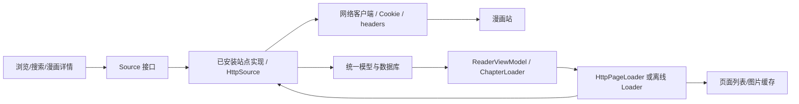

# Mihon：扩展契约、漫画页加载与离线下载

分析版本：`mihonapp/mihon@deeb9b2584b6e246135cbd31da49a39e6b6e1e52`。根许可证为 Apache-2.0；扩展及依赖可能有不同许可证。本文是静态分析，没有安装扩展、连接站点或运行 Android 客户端。

## 1. 主程序和站点扩展的边界

Mihon 核心负责目录浏览、搜索汇总、数据库、阅读器、缓存、下载和扩展管理。具体站点搜索 URL、DOM 选择器、章节与图片解析通常在扩展里，**主仓库无法独自说明所有漫画站的实际接口**。它提供的是完整宿主调用链与扩展接口。



源码版本已提供 suspend 形式的 `getPopularManga/getLatestUpdates/getSearchManga/getMangaUpdate/getPageList`。`getMangaUpdate` 可组合详情和章节更新。`CatalogueSource` 对部分旧 Rx 方法提供桥接，`ParsedHttpSource` 本身已标记 deprecated。给新开发 AI 的实现建议应优先围绕当前契约，而不是只照搬旧博客中的 `fetch*`。[M01](https://github.com/mihonapp/mihon/blob/deeb9b2584b6e246135cbd31da49a39e6b6e1e52/source-api/src/main/kotlin/eu/kanade/tachiyomi/source/Source.kt#L14-L106) [M02](https://github.com/mihonapp/mihon/blob/deeb9b2584b6e246135cbd31da49a39e6b6e1e52/source-api/src/main/kotlin/eu/kanade/tachiyomi/source/CatalogueSource.kt#L21-L47) [M21](https://github.com/mihonapp/mihon/blob/deeb9b2584b6e246135cbd31da49a39e6b6e1e52/source-api/src/main/kotlin/eu/kanade/tachiyomi/source/online/ParsedHttpSource.kt#L15-L81)

## 2. 扩展加载链

`ExtensionLoader` 校验扩展库版本、签名和信任状态，然后创建类加载器，根据 manifest 声明的类名实例化 `Source` 或 `SourceFactory`。外部扩展仓库列表与某个站点源实现是两层：仓库负责分发扩展包，扩展包才包含站点协议。仓库读取可对各源单独处理失败。[M17](https://github.com/mihonapp/mihon/blob/deeb9b2584b6e246135cbd31da49a39e6b6e1e52/app/src/main/java/eu/kanade/tachiyomi/extension/util/ExtensionLoader.kt#L350-L425) [M22](https://github.com/mihonapp/mihon/blob/deeb9b2584b6e246135cbd31da49a39e6b6e1e52/data/src/main/java/mihon/data/extension/repository/ExtensionStoreRepositoryImpl.kt#L114-L132)

签名信任意味着身份校验，不代表扩展在隔离沙箱内。对新的跨平台聚合器，如果需要第三方扩展，建议使用声明式适配器或隔离的 worker/WASM/子进程契约；如果仍选择原生插件，则必须明确权限和兼容版本。这是设计建议，Mihon 的 Android 类加载机制不能直接移植到 Web 前端。

`HttpSource` 包含 baseUrl、headers、网络 client 和 source identity。source id 的生成与名称、语言、versionId 等有关，改变身份会影响原有书架数据归属。新项目应维护稳定的 providerId，不能在每次改展示名称时重新生成。[M03](https://github.com/mihonapp/mihon/blob/deeb9b2584b6e246135cbd31da49a39e6b6e1e52/source-api/src/main/kotlin/eu/kanade/tachiyomi/source/online/HttpSource.kt#L28-L100)

## 3. 搜索链与分页

```text
SourceSearchPagingSource
  → source.getSearchManga(page, query, filters)
  → HttpSource 兼容实现 / 站点自己的实现
  → searchMangaRequest(page, query, filters)
  → client.newCall(request)
  → searchMangaParse(response)
  → MangasPage(items, hasNextPage)
  → 去重、网络模型转本地模型
  → 下一页 page+1 或结束
```

`HttpSource` 的 `searchMangaRequest` 和 `searchMangaParse` 需要站点实现；核心没有一个通用 `/search?q=` 地址。因此不能为 Mihon 编造“官方通用漫画搜索接口”。单源分页从默认第一页开始，会按 URL 去重，并将远端结果关联到 source id。[M04](https://github.com/mihonapp/mihon/blob/deeb9b2584b6e246135cbd31da49a39e6b6e1e52/source-api/src/main/kotlin/eu/kanade/tachiyomi/source/online/HttpSource.kt#L162-L198) [M07](https://github.com/mihonapp/mihon/blob/deeb9b2584b6e246135cbd31da49a39e6b6e1e52/data/src/main/java/tachiyomi/data/source/SourcePagingSource.kt#L15-L85)

全局搜索对选定 sources 发起首屏搜索，可以各源独立成功或失败，并取消上一轮搜索。其 dispatcher 使用 `limitedParallelism(5)`；这不是严格证明“全局最多 5 个 HTTP 请求同时在网络上进行”，因为协程挂起与网络并发是不同层。新的网络调度器若需要硬性每域名并发限制，应使用明确 semaphore/队列。[M18](https://github.com/mihonapp/mihon/blob/deeb9b2584b6e246135cbd31da49a39e6b6e1e52/app/src/main/java/eu/kanade/tachiyomi/ui/browse/source/globalsearch/SearchViewModel.kt#L130-L195)

## 4. 详情和章节同步

```text
MangaViewModel 观察本地 Manga/Chapter 状态
  → 未初始化或章节缺失时发起 fetch
  → UpdateMangaFromRemote
  → source.getMangaUpdate(manga, oldChapters, fetchDetails, fetchChapters)
  → 更新元数据
  → SyncChaptersWithSource
  → 去重、映射 sourceOrder、匹配本地章节
  → 本地 DB 更新驱动界面
```

远端详情与章节更新不是每次都必须同时请求，应由 flags 控制。`HttpSource` 默认详情请求和目录请求都可使用 `GET baseUrl + manga.url`，但解析函数不同；某站也可能覆盖为不同 API。新聚合器应允许单个响应提供详情和目录，避免重复下载同一页面。[M05](https://github.com/mihonapp/mihon/blob/deeb9b2584b6e246135cbd31da49a39e6b6e1e52/source-api/src/main/kotlin/eu/kanade/tachiyomi/source/online/HttpSource.kt#L243-L357) [M08](https://github.com/mihonapp/mihon/blob/deeb9b2584b6e246135cbd31da49a39e6b6e1e52/app/src/main/java/eu/kanade/tachiyomi/ui/manga/MangaViewModel.kt#L314-L380) [M09](https://github.com/mihonapp/mihon/blob/deeb9b2584b6e246135cbd31da49a39e6b6e1e52/app/src/main/java/mihon/domain/source/interactor/UpdateMangaFromRemote.kt#L55-L85)

章节同步按远端章节 URL 去重，再与数据库匹配；阅读状态不能因刷新目录而全部重置。章节的排序、章号识别、上传日期、扫描组等属于额外字段，不能把浮点 chapter_number 当成稳定主键。[M10](https://github.com/mihonapp/mihon/blob/deeb9b2584b6e246135cbd31da49a39e6b6e1e52/app/src/main/java/eu/kanade/domain/chapter/interactor/SyncChaptersWithSource.kt#L52-L120)

推荐的身份映射：

| 概念 | 稳定关联依据 | 不宜作唯一键 |
|---|---|---|
| Source | 稳定 source id | 可变展示名称 |
| Manga | source id + 远端 manga URL/ID | 标题、封面 |
| Chapter | manga key + 远端 chapter URL/ID | 列表下标、浮点章号 |
| Page | chapter key + index + 资源版本 | 临时签名图片 URL 单独作为业务 ID |

## 5. 阅读时如何拿到图片

`ChapterLoader` 先判断是否已有下载，然后选择 DownloadPageLoader；本地来源又可按目录、压缩包、EPUB 使用不同 loader；在线 HttpSource 使用 HttpPageLoader；源缺失有专门错误。文件读取与站点网络解析通过同一阅读器外观对接。[M11](https://github.com/mihonapp/mihon/blob/deeb9b2584b6e246135cbd31da49a39e6b6e1e52/app/src/main/java/eu/kanade/tachiyomi/ui/reader/loader/ChapterLoader.kt#L35-L112)

在线图片分两步，不能默认 page URL 就是最终图片 URL：

```text
chapter.url
  → pageListRequest（默认 GET baseUrl + chapter.url）
  → pageListParse
  → List<Page(index, url, imageUrl?)>
  → 若 imageUrl 缺失：getImageUrl(page)
      → imageUrlRequest（默认 GET page.url）
      → imageUrlParse → 最终图片 URL
  → imageRequest(page)，带 source headers
  → getImage(page, existingSize)
  → 图片响应写入缓存
  → ReaderPage 提供可打开的 stream
  → Ready
```

source headers 可能包含 User-Agent、Referer 或会话需要的其他字段，图片下载器不能在取得 imageUrl 后丢弃这些上下文。`Page.url` 可以是解析页，`Page.imageUrl` 才是最终资源；支持直接提供 imageUrl 的站点可以省掉中间一步。[M05](https://github.com/mihonapp/mihon/blob/deeb9b2584b6e246135cbd31da49a39e6b6e1e52/source-api/src/main/kotlin/eu/kanade/tachiyomi/source/online/HttpSource.kt#L243-L357) [M06](https://github.com/mihonapp/mihon/blob/deeb9b2584b6e246135cbd31da49a39e6b6e1e52/source-api/src/main/kotlin/eu/kanade/tachiyomi/source/online/HttpSource.kt#L365-L420) [M20](https://github.com/mihonapp/mihon/blob/deeb9b2584b6e246135cbd31da49a39e6b6e1e52/source-api/src/main/kotlin/eu/kanade/tachiyomi/source/model/Page.kt#L11-L57)

`HttpPageLoader.getPages` 先取页面列表缓存，未命中才调用 source.getPageList；加载器重新按列表顺序建立 index。当前可见页面优先加载，下载任务按页去重；切换加载窗口时取消不再需要的任务。预载按 chunk 和设置推进，不是简单地为整章同时开所有请求。关闭远距离预载时也仍保留附近窗口。[M12](https://github.com/mihonapp/mihon/blob/deeb9b2584b6e246135cbd31da49a39e6b6e1e52/app/src/main/java/eu/kanade/tachiyomi/ui/reader/loader/HttpPageLoader.kt#L43-L103) [M13](https://github.com/mihonapp/mihon/blob/deeb9b2584b6e246135cbd31da49a39e6b6e1e52/app/src/main/java/eu/kanade/tachiyomi/ui/reader/loader/HttpPageLoader.kt#L140-L258)

页状态可直接借鉴：`Queue → LoadPage → DownloadImage → Ready`，异常进入 `Error`，取消返回可重试队列并传播取消。页面列表为空、资源 403、图片实际是错误 HTML、解码不支持等，都应区别显示和重试。[M13](https://github.com/mihonapp/mihon/blob/deeb9b2584b6e246135cbd31da49a39e6b6e1e52/app/src/main/java/eu/kanade/tachiyomi/ui/reader/loader/HttpPageLoader.kt#L140-L258) [M20](https://github.com/mihonapp/mihon/blob/deeb9b2584b6e246135cbd31da49a39e6b6e1e52/source-api/src/main/kotlin/eu/kanade/tachiyomi/source/model/Page.kt#L11-L57)

## 6. HTTP、缓存与下载

`NetworkHelper` 中的示例基础参数是连接 30 秒、读取 30 秒、调用 2 分钟、HTTP 缓存 5 MiB，并统一挂 CookieJar 与拦截器。这些是此版本的实现选择，不是聚合器必须照抄的容量指标。HTTP 缓存、页面列表缓存、已下载章节和阅读历史是不同层。[M19](https://github.com/mihonapp/mihon/blob/deeb9b2584b6e246135cbd31da49a39e6b6e1e52/core/common/src/main/kotlin/eu/kanade/tachiyomi/network/NetworkHelper.kt#L30-L81)

离线下载链：

1. 获得章节 page list。
2. 在临时目录工作，补全缺失 imageUrl。
3. 逐页下载，按实际响应/文件特征处理格式。
4. 必要时使用已有文件大小继续下载，并按策略重试。
5. 确认章节完成后，再把临时目录改名为最终目录。

这是一个可恢复的阶段式任务。新实现若支持 Range 续传，还需验证 206/Content-Range、ETag 或 Last-Modified；服务器忽略 Range 返回 200 时必须重建文件，不能直接把完整响应附加到半文件。源码存在 `existingSize` 传递并不自动证明任意 CDN 的续传均可靠。[M14](https://github.com/mihonapp/mihon/blob/deeb9b2584b6e246135cbd31da49a39e6b6e1e52/app/src/main/java/eu/kanade/tachiyomi/data/download/Downloader.kt#L412-L509) [M15](https://github.com/mihonapp/mihon/blob/deeb9b2584b6e246135cbd31da49a39e6b6e1e52/app/src/main/java/eu/kanade/tachiyomi/data/download/Downloader.kt#L576-L612)

## 7. 阅读进度

`ReaderViewModel` 在选页后更新章节进度，并考虑隐身模式和错误状态；再通过数据库更新持久化。阅读进度、阅读历史、远端跟踪是相关但独立的动作。新项目不要在每次图片状态变化时都写一次全量书架。[M16](https://github.com/mihonapp/mihon/blob/deeb9b2584b6e246135cbd31da49a39e6b6e1e52/app/src/main/java/eu/kanade/tachiyomi/ui/reader/ReaderViewModel.kt#L541-L710)

漫画进度应保存 chapter stable key、page index、阅读方向/模式以及必要的图片内偏移；本地章节刷新时保持已读标记与用户收藏状态。可用 debounce 合并频繁位置变化，但在退出、切章或应用进入后台时执行持久化。

## 8. 如何给新聚合器落地

借鉴 Mihon 的重点：稳定 Source 契约、source-aware 数据库、元数据/目录同步、两步图片解析、按需预取、可取消图片状态机、离线章节原子完成。不要直接把 Android 扩展安装器塞进跨平台项目，也不要要求小说和视频都使用 Manga/Page 类型。

本报告已经定位宿主端从搜索到离线阅读的主链。要继续分析具体漫画站，必须另外指定并固定对应扩展源码与版本，再追踪其 `searchMangaRequest/searchMangaParse/pageListParse/imageUrlParse` 等实现；主仓库中不存在的站点请求不在本报告中冒充已还原。
