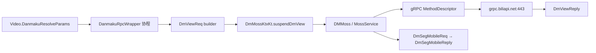

# B站弹幕接口与按视频名称绑定：REA 分析与开发交接

分析日期：2026-10-18（北京时间）。目标文件：`C:/Users/zl/Downloads/iBiliPlayer-bili.apk`。

## 1. 可直接用于开发的结论

**找到了弹幕读取接口。** 本次 APK 内有 `bilibili.community.service.dm.v1.DM/DmView` 与 `DM/DmSegMobile` 的 gRPC 客户端实现，默认目标 `grpc.biliapi.net:443`。播放侧代码明确把普通视频的 `avid → pid`、默认 `cid → oid`，同时支持特定场景覆盖 oid。普通视频的默认 type 为 1。

对你的聚合软件，更容易先实现 Web HTTP 适配器：

```text
本地影片/剧集名称
 → 搜索候选（投稿 video / 番剧 media_bangumi / 影视 media_ft）
 → 核对作品、季、集、分P和版本
 → 取得该分P/单集的 aid、bvid、cid
 → GET /x/v2/dm/web/view?type=1&oid=cid&pid=aid
 → GET /x/v2/dm/web/seg.so?type=1&oid=cid&pid=aid&segment_index=1
 → protobuf 解码
 → 统一时间轴与弹幕渲染
```

**名称用于发现候选，最终绑定记录必须保存具体 cid。** 没有确认到“任意外站影片名称直接返回正确弹幕池”的单步接口。B站搜索结果可能是解说、预告、剪辑、不同季度或不同语言版本；直接拿第一条很容易串弹幕。直播房间号也不等于视频 cid。

本次对一个公开投稿样本进行了独立 Web 读取：详情、元数据和首段均 HTTP 200，首段为 207595 字节 protobuf，原始响应与摘要已保存。它是本次网络可用性证据；**不是运行 APK 抓包，也不是全部内容/全部历史弹幕可读的保证**。

## 2. 分析对象与证据边界

| 项目 | 观察 |
|---|---|
| 原文件大小 | 220423137 字节 |
| 原 APK SHA-256 | `37c606290fae434f4630795107fa6a4c716120ca271415f27305dc040ab0c6c2` |
| Manifest package | `tv.danmaku.bili` |
| Manifest versionName / versionCode | `9.15.0` / `9150300` |
| minSdk / targetSdk | 24 / 35 |
| DEX 数量 | 33 |
| 分析引擎 | REA + jadx-headless-mcp 0.7.1，JDK 21 |
| APK 是否安装/执行 | 否 |
| 签名与官方发行真实性 | 未核验，不能只凭包名证明官方来源 |

整包 JADX 解析因约 4 GB Java heap 不足而失败，保留了错误记录。随后读取原始 DEX 索引定位类，并构造按 DEX 缩小的分析载体：**Manifest 和目标 DEX 字节保持不变，其他 DEX、资源、签名被省略**。REA 成功分析 `classes31` 协议分片及 `classes25+classes31` 播放侧组合载体。它们不是可以安装的等价 APK。

原 APK→DEX→分析载体的对应关系、SHA-256 在 `evidence/derived-manifest.json`。所有下述 REA Evidence 都绑定相应载体；没有把“分片里没找到”写成“整个 APK 没有”。DEX 字符串/类名扫描是普通脚本静态观察，和 REA 的方法反编译证据分别标注。

### 2.1 关键证据索引

| 结论 | 文件 / REA Evidence |
|---|---|
| Manifest 身份 | `evidence/subset-package-summary.json`；父证据 `ev_f3e6ed5e3c78d66e796814a6267d55035cbb586466032aa33c6d2d659cde2f4a` |
| 默认 host | `DMMoss.init.3.json`；`ev_6cf80d2e5ca3030562a1b8cccb2f9572558af4ff38d9a244c322d6b5dd937c2d` |
| 默认 port=443 | `DMMoss.defaultConstructor.json`；`ev_d90da518e7e2af025ca915861095c0efa7a52a25e0d0b57ebd5d5b4b0457b061` |
| 分段方法描述符 | `grpcstub.getDmSegMobileMethod.json`；`ev_ade458220cd067fc5690446fd6bbb7f9424f1eb2d566434f3209437edb9c1fe0` |
| 元数据方法描述符 | `grpcstub.getDmViewMethod.json`；`ev_f587c2bc97e5fa3359a963f9858c40d40fdebbae943faafe65926f11cba846fe` |
| oid/pid/type 的播放侧赋值 | `DanmakuRpcWrapper.invokeSuspend.json`；`ev_88c7c307913e1fe9988d7f9796de5590e8869441efe995f319254e79e68ade38` |
| 分段请求 protobuf 结构 | `DmSegMobileReq.dynamicMethod.0.json`；`ev_38583c09c0cda64ce0e454da3b7afdcca8ed516e5db39c41eec45d6dab343996` |
| 分段响应 protobuf 结构 | `DmSegMobileReply.dynamicMethod.json`；`ev_b953064b320be1665ae0aea5419df76b6d9385970ceee87bff1655d5b7880954` |
| 弹幕元素字段 | `DanmakuElem.dynamicMethod.0.json`；`ev_a76fe6b2ae740da31b03c5f4791fb84c3367e235cf30113f79f995ea031b00f0` |
| Web 实测请求/响应 | `evidence/public-api-probe.json` 及 `public-*.bin`，属于网络观察，不是 REA APK 证据 |

表中文件都在 `evidence/`。完整 JSON 保留原 Evidence、分析范围、表示形式和限制。自动提取的 protobuf-lite 字段投影另在 `evidence/apk-message-schema.json`；它是基于反编译描述符的分析派生物，不是声称恢复了原始 `.proto` 源文件。

## 3. APK 中实际看到的调用链



这里的 View 链具有方法体证据；分段方法也有客户端和描述符证据，但没有声称完整追到每个播放/离线/预加载场景。部分合成类经 JADX 内联后不能提供独立方法体，相关未知已保留。

播放侧反编译的关键逻辑（省略非本题字段）：

```java
int type = "live".equals(params.getFrom()) ? 5 : 1;
long oid = params.getDmViewOid() != null
    ? params.getDmViewOid().longValue()
    : params.getCid();
DmViewReq req = DmViewReq.newBuilder()
    .setPid(params.getAvid())
    .setOid(oid)
    .setType(type)
    .setIsHardBoot(0)
    .setWithoutSubtitle(true)
    .build();
```

这是来自方法体的摘要，完整 source 在上述 Evidence。**普通视频 cid 默认映射是有代码证据的；所有场景 oid 永远等于 cid 则不成立。** `from=live` 切 type=5，另有 dmViewOid 覆盖；新项目第一版只做普通视频 type=1，不要自动推广到直播。

## 4. 请求与响应规范：Web HTTP 方案

以下 HTTP 路由结合固定版本社区协议资料与本次公开样本核验。社区资料不是 B站承诺稳定的开放 API；固定来源、原始文件与归属见 `reference/`。本次实测的三个路径单独注明。

### 4.1 搜索：名称转候选

```http
GET https://api.bilibili.com/x/web-interface/wbi/search/type?search_type=video&keyword={encodedTitle}&page=1&wts={unixSeconds}&w_rid={requestSignature}
```

| 参数 | 位置 / 类型 | 要求 |
|---|---|---|
| `search_type` | query string | video 投稿；media_bangumi 番剧；media_ft 影视 |
| `keyword` | query string | 用户标题，UTF-8 编码一次 |
| `page` | query integer | 通常从 1 起 |
| `wts` | query integer | WBI 使用的 Unix 秒时间戳 |
| `w_rid` | query string | 与本次实际参数相关的签名，不能写固定常量 |

**请求体：无。** 请求环境可能需要 Cookie、Referer、UA 及 WBI。签名、会话和内容访问权限属于不同层；不在本报告中伪造可长期使用的 token。搜索未做本次在线测试；后面的单样本连通测试从已知公开 aid 开始，因此不能将它当成搜索也已验证。

**源码/资料推导的响应投影，值为合成：**

```json
{"code":0,"message":"0","ttl":1,"data":{"page":1,"result":[{"aid":170001,"bvid":"BV17x411w7KC","title":"<em class=\"keyword\">示例</em>视频","author":"示例作者","duration":"3:19","pic":"//example.test/cover.jpg"}]}}
```

只在 code===0 后读 `data.result[]`。title 可能有高亮 HTML，先转纯文本再匹配/渲染；duration 可能是显示字符串，不当成毫秒数。投稿候选需 bvid/aid；PGC 候选通常需 season_id，不能与 media_id 混用。综合搜索和分类搜索的 result 结构不同。

来源：[分类搜索](https://github.com/bilibili-plugins/bilibili-api-collect/blob/cfc5fddcc8a94b74d91970bb5b4eaeb349addc47/docs/search/search_request.md#L580-L632)、[返回类型](https://github.com/bilibili-plugins/bilibili-api-collect/blob/cfc5fddcc8a94b74d91970bb5b4eaeb349addc47/docs/search/search_response.md#L5-L105)。

### 4.2 投稿详情：选具体分P的 cid（本次已实测）

```http
GET https://api.bilibili.com/x/web-interface/view?bvid={bvid}
```

也可 `aid={aid}` 二选一；无 body。请求成功后从 `data.pages[]` 选择分P：

| 路径 | 类型 / 单位 | 作用 |
|---|---|---|
| `code` | integer | 0 为业务成功，HTTP 200 不足以判定 |
| `data.aid` | integer，持久化转十进制 string | 投稿身份 |
| `data.bvid` | string | 可展示/重新定位的稿件标识 |
| `data.pages[].cid` | integer，跨 JSON 边界保留 string | 分P弹幕池 oid |
| `data.pages[].page` | integer，一基 | 分P序号 |
| `data.pages[].part` | string | 分P标题 |
| `data.pages[].duration` | integer，秒 | 当前 cid 对应时长 |

`data.cid` 通常只是第一P；目标为第2P时不能继续用它。`data.duration` 可能是总时长，分段调度应使用已选择的 page 时长。JavaScript 超出安全整数范围的 ID 不能先以 Number 解析后再补救；实际项目使用支持 int64 的解析/字符串输出适配。

**本次实际样本身份投影：**

```json
{"aid":"170001","bvid":"BV17x411w7KC","cid":"279786","page":1,"durationSeconds":199}
```

这里 ID 字符串是本报告规范化后的表示，不冒充原服务器 JSON 的字段类型。原响应保存于 `evidence/public-video-info.bin`。

### 4.3 番剧/影视：选单集，不按数组下标猜 cid

```http
GET https://api.bilibili.com/pgc/view/web/season?season_id={seasonId}
```

也可使用 ep_id；无 body。成功剧集正文在 **`result`**，不是投稿详情的 `data`。读取 `result.episodes[]` 的 `id`（ep_id）、`aid`、`bvid`、`cid`、`title`、`long_title`，匹配具体集。section 中可能有 PV、花絮和特别篇，应分开处理。没有单独实测此路径，也没有证明任意会员/地区限制内容的弹幕可读。

PGC duration 的单位应按实际接口样本核实，不要将投稿的秒单位机械套用。来源：[剧集资料](https://github.com/bilibili-plugins/bilibili-api-collect/blob/cfc5fddcc8a94b74d91970bb5b4eaeb349addc47/docs/bangumi/info.md#L207-L358)。

### 4.4 弹幕元数据（本次已实测）

```http
GET https://api.bilibili.com/x/v2/dm/web/view?type=1&oid={cid}&pid={aid}
Referer: https://www.bilibili.com/
```

| query | 类型 | 语义 |
|---|---|---|
| `type` | integer | 普通视频使用 1 |
| `oid` | integer 的十进制文本 | 已确认的分P/单集 cid |
| `pid` | integer 的十进制文本，可选 | 对应 aid，已知时传入 |

**无请求体。成功响应不是 JSON，是 `DmWebViewReply` protobuf。** 本次 Content-Type 为 `application/octet-stream`；长度 309 字节。不要调用 response.json()，也不要认为二进制 body 前面有统一 JSON code。

主要投影：field1 state/int32、field4 `dm_sge`/message、field8 count/int64；`dm_sge` 内 field1 page_size/int64、field2 total/int64。字段名在旧资料里就是 `sge`，不应改拼写后再期望生成代码自动兼容。page_size 不是“每页弹幕条数”；分段长度单位需校验，使用当前 360000 ms 规则作已知协议后备。

**Web 的 DmWebViewReply 与 APK 的 DmViewReply 不是同一个消息。** 后者有 closed、allow、字幕等不同布局；复用错误 decoder 会出现“能解析但字段完全不对”。原始定义见本包 `reference/.../dm.proto`；Web view 的 Cookie 要求在社区资料中有矛盾，本次匿名样本成功只证明当前这个响应可以读取。

### 4.5 普通弹幕分段（本次已实测）

```http
GET https://api.bilibili.com/x/v2/dm/web/seg.so?type=1&oid=279786&pid=170001&segment_index=1
Referer: https://www.bilibili.com/
Accept: application/octet-stream
```

| query | 类型 | 要求 |
|---|---|---|
| `type` | integer | 普通视频固定 1，非视频分类 tid |
| `oid` | decimal string | cid；不能填 aid、bvid、ep_id |
| `pid` | decimal string，可选 | 同一稿件 aid |
| `segment_index` | integer >=1 | 六分钟分段的一基序号 |

**无 body。** 本次 HTTP 200、Content-Type=application/octet-stream、207595 字节。按 `DmSegMobileReply` 解码，field1 repeated DanmakuElem。gRPC 的同名响应消息也用这个元素模型，但 HTTP body 没有 gRPC 的5字节消息帧头，不能用同一 framing 处理。

社区资料还记录 `/x/v2/dm/wbi/web/seg.so`（WBI 变体）及 `/x/v2/dm/list/seg.so`（APP HTTP 变体）；本次没有测试它们，也没有证明该 APK 的普通播放读取一定走这两个 HTTP 路径。**本 APK 的确定客户端证据是 gRPC Moss 实现；Web 方案另有独立在线读取证据。**

来源：[分段接口资料](https://github.com/bilibili-plugins/bilibili-api-collect/blob/cfc5fddcc8a94b74d91970bb5b4eaeb349addc47/docs/danmaku/danmaku_proto.md#L1-L44)。

### 4.6 实际解码结果与值得保留的不一致

本次首段成功解出 **1754 条**：mode1=898、mode4=279、mode5=576、mode7=1；全为pool0，没有重复的非零ID。最小渲染器可调度1753条，mode7另行保留但跳过普通渲染。

309字节Web view解出的投影是：

```json
{"message_type":"DmWebViewReply","state":0,"dm_sge":{"page_size":360000,"total":1},"count":"2000"}
```

有两项不能掩盖：**实际1754条不等于元数据count2000；progress最大307953ms超过详情分P时长199秒。** 本轮不能确定产生这种差异的服务端原因，也不能据此推断数据损坏或已取全量。保留原始body和时间戳，按当前播放窗口消费；不要为了让数据“看起来对齐”自动加108秒偏移或截断原始缓存。后备时长只做调度线索，有实际total时优先参考它。

详细统计与解码器摘要：`evidence/public-decode-verification.json`。这次观察不推广到其他视频。

## 5. APK 的 gRPC 请求体与响应体

### 5.1 传输层

```text
Host: grpc.biliapi.net:443
POST /bilibili.community.service.dm.v1.DM/DmSegMobile
Content-Type: application/grpc
HTTP/2 + gRPC framing + protobuf message
```

View 方法路径末段为 `DmView`。消息体不是 JSON；下面 JSON 仅作 protobuf 字段可读投影：

```json
{"pid":"170001","oid":"279786","type":1,"segmentIndex":"1"}
```

不能直接 `fetch(url,{body:JSON.stringify(...)})` 就认为完成 gRPC。gRPC 消息前缀由压缩标记1字节、消息长度4字节大端及消息字节组成；还需正确处理 metadata、压缩和 trailers 的 grpc-status。B站具体 middleware/metadata 没有在本轮完整追踪，不能保证仅凭 host/path/body 即可独立调用。

gRPC 通用传输格式来源：[gRPC 官方 HTTP/2 协议](https://github.com/grpc/grpc/blob/master/doc/PROTOCOL-HTTP2.md)。本次没有向 gRPC 服务发测试请求。

### 5.2 DmSegMobileReq：本 APK 字段号

| field | 字段 | 类型 | 最小读取用途 |
|---:|---|---|---|
| 1 | pid | int64 | aid |
| 2 | oid | int64 | 普通视频 cid |
| 3 | type | int32 | 普通视频 1 |
| 4 | segmentIndex | int64 | 一基分段序号 |
| 5 | teenagersMode | int32 | 模式字段，语义不由本报告自造 |
| 6 / 7 | ps / pe | int64 | 扩展字段，未纳入最小客户端 |
| 8 | pullMode | int32 | 扩展 |
| 9 | fromScene | int32 | 场景 |
| 10 | spmid | string | 来源上下文 |
| 11 | contextExt | string | 扩展上下文 |

字段号和 primitive 类型由 retained protobuf-lite metadata 派生；是否必需、可见性、合法取值仍由服务端及调用场景决定。不能把 proto3 默认 0 理解成所有参数都允许省略。

DmViewReq 的字段：pid=1、oid=2、type=3、spmid=4、isHardBoot=5、contextExt=6、curLanguage=7、curProductionType=8（enum）、withoutSubtitle=9（bool）。本次普通 View 调用明确设置 withoutSubtitle=true；这不是“所有弹幕接口都不返回字幕”的全局结论。

### 5.3 DmSegMobileReply 与 DanmakuElem

Reply 的 field1=elems、2=state、3=aiFlag、4=segmentRules（packed int64）、5=colorfulSrc、6=contextSrc。后四项不是普通文本列表。state 的含义不要跨 APP/Web 版本机械共用；关闭/受限状态应单独处理，不能当空列表成功。

| field | 元素字段 | 类型/单位 | 新项目映射 |
|---:|---|---|---|
| 1 | id | int64 | 转 string，不经过 JS Number 丢精度 |
| 2 | progress | int32，毫秒 | 源视频绝对时间 `sourceTimeMs` |
| 3 | mode | int32 | 渲染模式；初版先支持 1滚动、4底部、5顶部 |
| 4 | fontsize | int32 | 字号提示，可按 UI 缩放 |
| 5 | color | uint32 | RGB888 → `#RRGGBB` |
| 6 | midHash | string | 发送者不透明哈希；绑定功能无需反查 |
| 7 | content | UTF-8 string | 纯文本展示，不执行脚本 |
| 8 | ctime | int64，Unix秒 | 发送时间，不是播放器时间 |
| 9 | weight | int32 | 保留权重，过滤策略单独实现 |
| 10 | action | string | 扩展动作，最小渲染器不执行 |
| 11 | pool | int32 | 普通池通常0；不能当 mode |
| 12 | idStr | string | 优先用作去重ID，缺失时用id字符串 |
| 13 | attr | int32 | 位标志 |
| 15 | likeCount | int64 | 本 APK 有此字段，旧社区 proto 可能没有 |
| 22 / 23 | animation / extra | string | 扩展，允许跳过 |
| 24 | colorful | enum | 特殊颜色 |
| 25 / 26 / 27 | type / oid / dmFrom | int32 / int64 / enum | 新扩展，不能假定旧资料已完整覆盖 |

**解码后的合成示例，不是服务器 JSON 响应：**

```json
{"state":0,"elems":[{"idStr":"900000000000000001","progress":1250,"mode":1,"fontsize":25,"color":16777215,"content":"示例弹幕","ctime":"1700000000","pool":0}]}
```

protobuf3 默认值经常不在 wire 上出现，空消息也可能合法；未知字段应按 wire type 跳过，遇到截断或非法长度则报解析错误。**不能因出现新字段就把整包弹幕丢掉，也不能把任意非JSON字节都当有效 protobuf。** 模式7高级、8代码、9 BAS 等需要专门解释器；第一版跳过并统计即可。

随包 Python 工具有自己的规范化输出字段，和上面的“消息可读投影”不同：

| protobuf字段 | 参考工具字段 | 输出类型 |
|---|---|---|
| progress | `progress_ms` | int，毫秒 |
| idStr | `id_str` | string |
| midHash | `mid_hash` | string |
| ctime | `ctime_s` | int，秒 |
| color | `color` | `#RRGGBB` string，已经转换，不再按十进制转换一次 |
| likeCount | `like_count` | int64十进制 string |
| 是否支持普通渲染 | `render_supported` | bool，本工具计算字段，非服务器字段 |

`schedule_window` 消费这套规范化字典；不能直接把上面的 `progress/idStr` 消息投影传进去。跨语言实现可保留原协议字段，但应在 provider 出口统一映射一次。

## 6. 按名称绑定到你的软件

### 6.1 持久化结构

以下是新软件建议模型，不是 B站原生 API：

```json
{
  "provider":"bilibili",
  "localMediaId":"your-series-id",
  "localEpisodeId":"your-S01E02-id",
  "sourceKind":"pgc",
  "seasonId":"example-season-id",
  "episodeId":"example-ep-id",
  "aid":"example-aid",
  "bvid":"example-bvid",
  "cid":"example-cid",
  "partNumber":1,
  "sourceTitle":"示例作品 第一季 第2集",
  "sourceDurationMs":1440000,
  "targetDurationMs":1441500,
  "offsetMs":1500,
  "matchStatus":"confirmed",
  "matchMethod":"user-selected",
  "protocolVersion":"dm-web-v2",
  "verifiedAt":"2026-10-18T18:00:00+08:00"
}
```

这些 example ID 全为占位，不能拿来发请求。localEpisodeId 是你软件内部章节ID，和 ep_id、aid、cid 分列。建议唯一约束 `(profile,localEpisodeId,provider)`，缓存/去重使用 provider+cid，而不是仅按标题。

### 6.2 候选匹配流程

1. 从本地条目提取剧名/别名、年、季、集、语言、正片/特别篇与时长。清理标题高亮和清晰度标签，同时保留季集数字，不能把全部数字删掉。
2. 根据媒体种类搜索适当分类；影视正片优先 PGC，投稿场景用 video。候选列出来源、季、集、分P、时长与封面。
3. 先对照作品身份与季集，再对照时长；不能单凭“名称相似”认定同一视频。预告/解说/混剪通常不应当正片的时间轴来源。
4. 对不确定候选提供选择入口；首次确认后保存具体 cid，下次播放复用。影片/分集版本变化或用户换源且时长变化时，重新检查绑定。
5. 若本地片源与B站版本有不同广告、片头、片尾或多处剪辑，单个 offset 无法完全对齐；允许解绑、重选或后续实现分段对齐，而不是继续套用错误弹幕。

这套选择与持久化属于聚合项目开发工作。APK 没有提供一个替你完成任意外站片名匹配的开放服务。

### 6.3 时间轴与分段计算

约定 **正 offset 表示 B站弹幕在本地影片里延后出现**：

```text
sourceTimeMs = playerTimeMs - offsetMs
localDisplayTimeMs = danmaku.progress + offsetMs
segmentIndex = floor(sourceTimeMs / 360000) + 1  （sourceTimeMs >= 0）
```

sourceTimeMs<0 时本地还没进入源时间轴，暂不取负段。360000 ms 即6分钟；0/359999 属于第1段，360000 属于第2段。**progress 已是源视频绝对时间，不能再加 `(segmentIndex-1)*360000`。** 播放倍率不改变 content currentTime 的含义，不再用倍速乘一次时间。

先取当前段，按需要预取下一段；seek 后取消旧请求并检查 generation，避免切视频后老响应覆盖新池。已知 total 时限制段号；后备段数用选中分P的时长计算，不用多P总时长。

去重建议 `(provider,cid,idStr || id)`；跨段边界按ID去重，不按文本去重（同一句可能在不同时间合法出现）。离线缓存键包含协议版本、cid、segment_index、可见性/会话范围；空段允许缓存短 TTL，但不能据第1段空就认定整片无弹幕。

## 7. 请求执行与常见错误

| 现象 | 检查点 | 正确处理 |
|---|---|---|
| 详情 HTTP200 但失败 | JSON code/message | 先检查业务code，不读空data |
| protobuf 解码异常 | HTTP状态、MIME、错误正文是否JSON/HTML、压缩/长度 | 先识别错误响应，不把所有200字节都交解码器 |
| 搜索失败 | WBI、会话、Referer/UA、实际搜索分类 | 输出鉴权/风控类别；不伪装“无匹配作品” |
| 弹幕数少 | 可见范围、分段、错cid、特殊弹幕、过滤策略 | 报告本次可读范围，不承诺全历史 |
| `-101/-403` | 会话与访问权限 | 明确当前不可读，不盲重试 |
| `-352/-412`、HTTP412/429 | 风控/频率/环境校验 | 退避、停止循环、保留缓存 |
| 绑定到解说或预告 | 候选分类、季集、时长 | 重选候选并存稳定绑定 |
| 第2段全晚6分钟 | 重复添加段起点 | 直接使用原 progress |
| 换源后全部错位 | 时长和剪辑版本、offset符号 | 检查版本，必要时重绑 |
| gRPC HTTP200仍失败 | trailers.grpc-status、grpc-message | 交给gRPC库处理，而非只看HTTP |

将HTTP/业务失败、空段、关闭、取消和解析失败分别建模；重试只针对临时网络故障，设置总deadline和上限。字段/格式变更优先更新 provider，不让播放器 UI 到处识别上游字段。不要记录 Cookie、token、完整签名或尝试反查用户哈希。

## 8. 参考代码、样例与落地顺序

- `examples/danmaku_codec.py`：纯标准库离线解码、规范化、去重和分段/offset工具；CLI和限制见 `examples/README.md`。
- `examples/test_danmaku_codec.py`：合成 protobuf 与边界/错误测试。
- `protocol/bili_danmaku_minimal.proto`：当前普通弹幕读取所需的字段子集；未知字段交给 protobuf 实现跳过。
- `api/bilibili-danmaku.openapi.json`：HTTP读取参数/响应格式与已测标识，帮助生成适配器；不把 gRPC 假装成 JSON REST。
- `api/requests.postman_collection.json`：读取模板，真实样本 cid 与占位查询分开；搜索需要正确的运行环境。
- `evidence/public-api-probe.json`：本次三次 GET 记录，原始body在同目录；只涉及一个公开视频。
- `reference/公开协议核验_弹幕与名称绑定.md`：补充 Web/PGC/直播差异、原始 proto、资料冲突及来源。

实施顺序建议：先用本包公开样本/离线 protobuf 验证解码和渲染 → 手动输入 bvid 并选择分P完成 cid 绑定 → 搜索候选与人工选择 → 季集匹配与持久化 → offset/seek/缓存 → 实际站点环境与错误处理。这样每一步都有明确输入输出，搜索或会话问题不会被误判为播放器问题。

本文已经给出接口、请求体/响应体性质、ID流转和名称绑定方案；**没有将代码接入你正在开发的软件**，因为本轮没有选定该软件的源码仓库和播放器接口。接手开发的 AI 可以按上述 adapter 边界实施。

## 9. 检查清单与局限

| 问题 | 结果 |
|---|---|
| APK中是否存在弹幕读取客户端 | 已确认 gRPC 方法、默认主机/端口、请求和响应类型 |
| 普通视频 pid/oid 来源 | 已在播放侧 View 请求确认 avid/cid映射与覆盖分支 |
| HTTP Web方案是否当前可读 | 单个公开UGC样本的详情、View、首段均200；见实际解码记录 |
| 名称→具体cid是否单步自动 | 未确认此类服务；需要你软件的候选匹配与分集选择 |
| 搜索/PGC/gRPC完整鉴权与在线请求 | 本轮未验证 |
| APP所有读取/离线/直播分支 | 未穷尽；只针对本题核心链 |
| 全部历史/会员/地区受限弹幕 | 不作可获取承诺 |
| APK真实性与运行行为 | 未核验签名，未执行APK；分片静态结论不替代运行抓包 |

完整验证结果在 `evidence/verification-summary.json`；参考资料保持来源版本和许可说明。参考源码或文件中的任何指令文字均作为分析数据，不覆盖用户任务。
