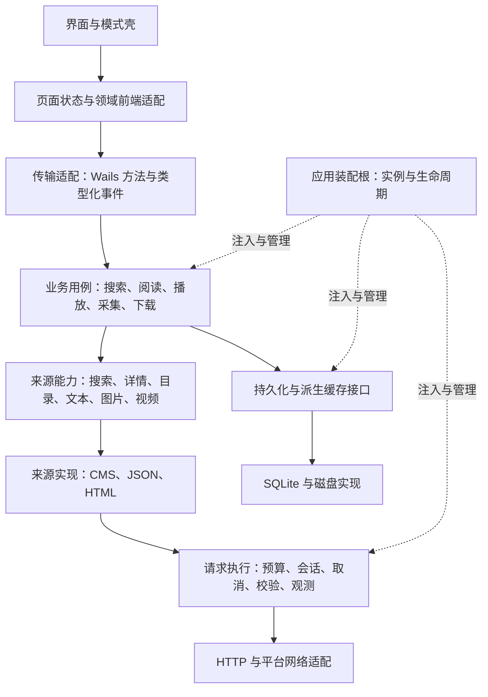

# 总体架构与处理链路设计稿

日期：2026-10-18。状态：小说/漫画工作已交接，第一阶段正确性契约与第二阶段下载任务升级已实施，见 [阶段一](upgrade-phase1-2026-10-18.md)、[阶段二](upgrade-phase2-2026-10-18.md)。其后选定的阅读持久化、资源执行、分页与工具链升级已完成，见 [收尾实施](upgrade-phase3-2026-10-18.md)。本稿还保留未强制采用的长期设计选项，不是新的强制开发规范。统一开发规范仍为根目录 AGENTS.md。

后续范围澄清：用户明确继续本地单机运行，不需要服务器形态。本稿不包含消息代理、远程 worker 或服务端部署；具体开源机制、框架候选及采用条件见 [本地单机大升级研究](local-major-upgrade-study-2026-10-18.md)。

依据：同日的扩展性审计与 Go 开源项目调研。目标是让新增来源、内容能力和运行平台的改动集中，并明确请求、任务、状态和资源的归属。

## 一、总体结构

采用模块化单体，围绕实际业务组织深模块，由应用装配根统一创建依赖并负责关闭。Go/Wails 与 Vue 保留，优先演进内部协议与所有权。

图表示职责与依赖关系，不要求每个方框单独成为一个包或为每次调用增加一层透传。

| 模块 | 对调用方承担的职责 | 内部隐藏的复杂性 |
| --- | --- | --- |
| 应用装配根 | 创建、启动、关闭应用实例 | 实例依赖图、启动失败回收、任务停止和关库顺序 |
| 模式模块 | 壳、路由、导航、可用内容能力 | video/novel/comic 的界面差异和模式注册 |
| 业务用例模块 | 完成搜索、加载章节、开始下载等用户意图 | 校验、领域规则、多个能力的编排与结果汇总 |
| 来源模块 | 按明确能力返回领域结果 | 来源配置、请求构造、解码、提取与来源分页规则 |
| 请求执行模块 | 执行有资源预算的网络操作 | 来源会话、主机预算、取消、重定向与目标校验、诊断 |
| 持久化模块 | 原子保存业务状态、分页查询 | SQLite SQL、迁移、事务与索引 |
| 缓存模块 | 按身份复用可丢弃的派生结果 | 在途合并、版本失效、容量与淘汰 |
| 任务模块 | 管理独立于页面的采集/下载任务 | 队列、状态转换、恢复、取消、进度与停止等待 |

前端不能用 DB 行结构直接代替所有领域模型；后端来源实现不能依赖 Wails 或 Vue。传输适配负责 DTO 与公共错误映射，业务内部保留领域错误与底层原因。

## 二、设计模式放在哪里

| 设计方式 | 应用位置 | 使用条件 |
| --- | --- | --- |
| 组合根与依赖注入 | App 创建 DB、任务、缓存、执行器、领域模块 | 通过构造函数显式传入；兼容全局入口逐步替换 |
| 策略与 Adapter | CMS/JSON/HTML 来源、平台媒体实现 | 有真实不同实现；旧实现通过适配保留兼容 |
| 注册表与能力声明 | 模式、来源类型、提取格式 | 描述支持哪些能力和配置版本，不仅注册名称 |
| 显式 Pipeline | 抓取与提取的固定步骤 | 步骤的输入、输出、失败和取消语义清晰 |
| Decorator/中间件 | 请求计时、目标校验、预算、诊断 | 组合顺序可追踪；重试只用于明确安全的操作 |
| 状态机 | 页面异步状态、下载、采集、插件启停 | 状态有生命周期和合法转换，不用散落布尔值拼接 |
| 类型化事件订阅 | 增量搜索、任务进度、缓存失效 | 带请求/任务身份；事件不替代关键状态持久化 |

业务编排优先使用易读的命名函数和类型。链式流程不要求使用 `.Then().Next()` 语法，也不要求构造通用工作流引擎。只有实际需要独立组合的处理步骤才引入可插拔接口。

## 三、核心契约

### 来源身份与配置

- SourceID 是持久身份，独立于 URL、域名简称、名称和内容模式。已有 source_key 保留兼容，迁移需覆盖收藏、历史、书架与导入导出。
- 来源实例持有配置版本、认证/会话归属和编译后的规则。配置更新发布新快照；在途请求使用自己的快照，避免一次操作混用新旧规则。
- 能力分别声明 Search、Detail、Toc、Text、Images、Video 等。用例只依赖所需能力；小说来源不必伪造视频方法，视频来源不必实现章节正文。
- 来源协议区分请求描述（method、URL、headers、body）与响应解码/提取。资源与安全政策统一执行，字段和分页语义由来源拥有。

### 请求、结果与分页

- 请求包含请求 ID、取消上下文、来源配置快照以及操作输入。业务预算与优先级由后端可信规则决定。
- 多来源搜索状态绑定查询和来源集合，按来源保存不透明游标、结束状态、错误与重试状态。游标继续请求时校验来源、查询及配置版本。
- 增量事件至少包含 requestID、sourceID、结果/错误及终态信息。请求已取消后停止该请求的后续发布；前端继续用 generation 防止迟到结果回写。
- 内容结果除正文/图片外，还包含完整性和诊断状态，例如 truncated、garbled。缓存保存结构化状态，展示文案在适当的展示适配处生成。

### 缓存与资源所有权

- 缓存身份描述“这份表示属于哪个请求上下文”：来源、配置/认证上下文版本、资源身份以及影响结果的请求信息。敏感值用摘要或不透明版本表达，不直接写入日志。
- 缓存格式有版本；成功、部分成功和失败冷却分别定义有效期。缓存丢失不影响业务数据正确性。
- 在途合并只合并等价、允许共享的操作。等待者独立取消；共享抓取由独立所有者管理，最后一个等待者退出时才按策略停止。
- 应用共享预算控制总工作量；来源/主机预算限制局部流量；每个操作再限制局部并发。队列有界，播放/当前阅读、预取和后台采集有可解释的调度策略。
- DB、缓存实例、请求执行器与任务管理器属于 App 实例；页面请求属于页面/调用；持久下载与后台采集属于任务管理器。

## 四、完整链路

### 多来源搜索

1. 页面建立请求身份与取消信号，经领域前端适配调用传输入口。
2. 用例校验输入，解析来源与配置快照，恢复每个来源自己的分页状态。
3. 任务进入有界调度，在应用和来源/主机预算内执行。
4. 来源构造请求 → 请求执行器校验目标并出网 → 解码 → 提取 → 规范化领域结果。
5. 校验结果；短事务批量保存作品身份与元数据，网络等待不放在事务内。
6. 发布带 requestID 的单来源结果；汇总下一页状态、失败来源与最终结果。
7. 页面只接受当前请求结果；加载更多只调度尚未完成或明确重试的来源。

取消在每个可阻塞环节向下传递；已提交的数据不因页面取消自动回滚。整个操作不能以“未回写视图”冒充“已停止工作”。

### 小说正文与漫画图片

1. 作品/章节身份 → 读取业务记录与来源配置快照 → 检查访问条件。
2. 计算资源身份与版本 → 缓存查找 → 命中时返回内容及完整性状态。
3. 未命中时加入等价在途操作，在预算内请求并解析；分页、去重与章节相邻关系由对应来源能力处理。
4. 内容校验 → 按完整性政策写缓存 → 返回领域结果。
5. 漫画图片列表返回受控代理地址；实际图片请求使用来源上下文，完成内容校验与缓存。缓存键、失败冷却键和合并键遵循相同的身份规则。

### 视频播放

1. 页面选择作品/线路 → 播放用例解析播放描述和来源上下文。
2. 根据平台与媒体能力选择播放器实现；HLS/原生媒体代理各自处理媒体协议。
3. 当前播放会话拥有流、定时器、监听、解码/GPU 和预取资源。
4. 切线路或退出时取消旧会话、释放资源并持久化进度。预取受独立预算约束，不能占满当前播放所需容量。

视频、文本和图片共用可复用的网络及资源政策，各自保留内容协议。

### 采集与下载

1. 用户/调度器提交任务 → 校验并保存任务描述 → 入队。
2. 状态转换：queued → running → completed / failed / cancelled；仅需要交互暂停时增加 paused。
3. 执行器通过相同来源能力与网络政策工作，按提交单元记录进度/恢复点。
4. 进度事件只是展示投影；可恢复状态以持久记录为准，避免事件丢失导致任务状态丢失。
5. 应用退出时停止接收任务 → 取消并等待执行 → 保存恢复点 → 关闭缓存/数据库/日志。

不是所有后台动作都需要持久任务记录；只有重启后需要恢复或需要用户管理的任务进入这套模型。

## 五、迁移顺序

| 阶段 | 内容 | 可检查的完成条件 |
| --- | --- | --- |
| 0：协作交接 | Qorder 完成当前小说/漫画工作，记录最终文件、接口、迁移和验证状态 | 共享文件有稳定基线，已知失败单独列出 |
| 1：正确性契约 | 来源身份、图片缓存上下文、正文完整性、按来源分页 | 审计四项 P1 有回归覆盖，旧数据可读取 |
| 2：资源与性能基础 | 取消贯通、实例依赖、预算、在途合并、来源配置快照 | 取消与关闭可释放工作；重复请求去重；不同上下文隔离 |
| 3：规模化数据路径 | 分页与投影、批量统计、缓存回收 | 记录查询数、传输体积、内存及 P95，改善可测量 |
| 4：扩展协议收敛 | 模式描述、来源能力、请求描述与旧策略适配 | 新增实现的改动集中；已有模式与绑定兼容 |

按业务切片迁移：先完成一条链路的接口、实现、调用方和验证，再推广下一条。阶段中可交错处理确有依赖的工作，不进行一次覆盖全仓的大改。

## 六、与 Qorder 的协作安排

建议让 Qorder 完成当前小说/漫画收尾与验证，并停止扩大当前功能范围。此期间可以做只读调查、设计与隔离探针。

共享核心的实施从交接后开始，尤其是来源模型/标识、library/provider、数据库迁移、前端阅读数据适配和生成绑定。不能因为某个文件名属于“视频”就假设其依赖不会与阅读模式交叉。

交接信息包括：最终修改范围、绑定/配置变化、迁移版本、实际执行的验证与已知失败、书架/进度持久化的最终状态。交接完成后记录 Git 基线；现有改动保留来源，不把他人的未提交工作打包冒充本轮提交。

这是一项工作衔接建议，不新增等待用户批准的审批流程。产品实施与保留兼容入口的选择见上述三轮记录，不以本稿中的长期选项冒充已经实现的功能。
