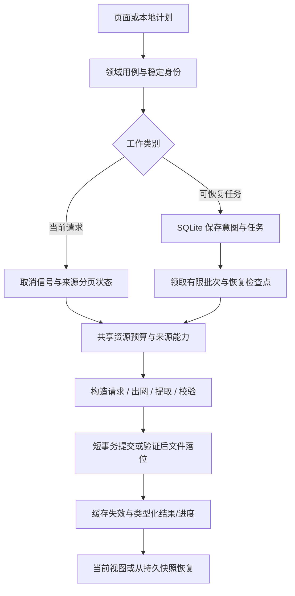

# 本地单机大升级：开源机制与框架选型研究

调查日期：2026-10-18。用户已明确：继续本地单机运行，不需要服务器形式。本文据此收敛此前架构设计，不规划消息代理部署、远程 worker、微服务或服务端数据库。

本文是设计与研究证据，不是新增开发规范，也不表示下述升级已在产品代码落地。统一规范仍为 AGENTS.md。

## 结论与选型

本次应升级应用运行时、来源能力、数据访问、持久任务、缓存和前端工程链。其规模可以很大，但升级理由应是解决已核实的行为缺口，并通过故障恢复与性能测量证明收益。

当前不采用 RabbitMQ。它可以在同一台电脑运行，但 Windows 安装仍涉及 Erlang 与 RabbitMQ 节点/服务；这会改变本产品的交付与运行依赖。用户已经排除了服务器形态，我们没有跨进程消息分发需求证据。[官方 Windows 安装](https://www.rabbitmq.com/docs/install-windows)

消息可靠性也不能直接等同于业务正确性：发布确认与消费确认分属不同环节；副作用执行成功、确认尚未完成时，应用仍需考虑重复处理。[RabbitMQ 确认机制](https://www.rabbitmq.com/docs/confirms)

以下“纳入/候选/排除”是基于本项目需求作出的判断，不是上游项目的官方评价。

| 方向 | 本次决策 | 具体范围 |
| --- | --- | --- |
| Go + Wails + Vue + SQLite | 保留并深化 | 重构内部职责和生命周期，按兼容组合升级工具链 |
| 本地持久任务模块 | 纳入实施 | 任务状态、领取、检查点、取消、有限重试、崩溃恢复与历史保留 |
| River SQLite | 技术验证候选 | 已有 SQLite 支持，但官方仍标 experimental；先验证收益和迁移代价 |
| x/sync、x/time/rate 等进程内库 | 按实际功能引入 | 合并等价请求、结构化并发、来源/主机限速；补齐预算与取消所有权 |
| sqlc | 小范围验证候选 | 对静态查询生成带类型方法；SQLite 官方支持状态为 Beta，不直接全仓替换 |
| Uber Fx | 装配复杂度对比候选 | 比较手工构造与 Fx 的依赖图、生命周期、诊断及测试代价，Wails 仍拥有主循环 |
| robfig/cron | 有日历调度需求时采用 | 负责触发时间，不负责持久任务、恢复和业务幂等 |
| Wasm 后端扩展 | 插件能力验证候选 | 来源/提取等无 DOM 扩展；先验证平台、资源释放、ABI 和现有插件兼容 |
| RabbitMQ / NATS / Redis / Temporal | 本轮不引入 | 不新增常驻外部服务，也不为其设计通用替换层 |

并发库的官方职责分别是重复调用抑制、任务组错误/取消，以及令牌桶；它们各自不能单独构成完整调度器。[singleflight](https://pkg.go.dev/golang.org/x/sync/singleflight)、[errgroup](https://pkg.go.dev/golang.org/x/sync/errgroup)、[rate](https://pkg.go.dev/golang.org/x/time/rate)

## 阅读范围与可复现性

本轮新增四个开源应用样本，并与上一轮 Prometheus/Grafana/etcd 的研究组合使用。固定版本用于审阅机制，不宣称是最新版本，更不建议安装这些应用替代本项目。

| 样本 | 审阅版本 | 对应问题 |
| --- | --- | --- |
| Gitea | v1.24.6 | 嵌入式队列、批处理、限额、存储与执行分离 |
| Navidrome | v0.61.2 | 媒体扫描阶段、断点状态、调度与插件协议 |
| Syncthing | v1.30.0 | 长驻后台模块监督、退出、缓冲事件与慢消费者 |
| PocketBase | v0.28.4 | SQLite 读写连接管理、应用实例、类型化 hook 链与事务后回调 |

已从官方 raw 地址读取并保存 13 个固定 tag 文件为 `.txt`，避免加入项目 Go 构建。清单含 URL、字节数与 SHA-256：`framework-upgrade-study-2026-10-18/source-manifest.json`；复取脚本：同目录 `fetch_sources.py`。脚本中两个额外探测文件返回 404，清单已记录，未作为证据。GitHub API 限流、Git 连接失败后改用官方 raw 地址，没有因此声称读到了未取得的文件。

此外阅读了官方在线文档。Navidrome master 插件文档包含固定 v0.61.2 未出现的新任务接口；下文明确分别引用，不将 master 能力倒写为该发布版本已有功能。在线说明可能变化，实施时需固定实际候选版本重新核验。

没有构建、运行或压测这些上游应用；未安装候选库；没有因其公开基准宣称本产品会提高某个倍数。

## 开源项目具体做了什么

### Gitea：把队列存储、工作池与处理器分开

v1.24.6 的 queue 包描述了 Item、Batch、Worker、Handler 和 WorkerPoolQueue；底层接口支持上下文、入队、出队、长度和关闭，同一职责下有 channel、嵌入 LevelDB 和 Redis 等实现；配置默认选择 level，并有批量长度、最大 worker 等设置。[队列契约与说明](https://github.com/go-gitea/gitea/blob/v1.24.6/modules/queue/queue.go)、[底层接口](https://github.com/go-gitea/gitea/blob/v1.24.6/modules/queue/base.go)、[配置](https://github.com/go-gitea/gitea/blob/v1.24.6/modules/setting/queue.go)

**本项目采用的机制**：排队、状态存储和业务执行分开；限制积压、批量和在途工作；关闭行为明确。持久介质优先复用本项目 SQLite，不因 Gitea 使用 LevelDB 就额外增加一种存储。Gitea 代码是应用内部模块，不把它当成可以无代价直接导入的独立 SDK。

**保留判断**：该版本文档自己说明 unique 队列的 Has 不是事务性保证。唯一入队、唯一执行与副作用幂等必须分别处理，不能复制名称就宣称“绝不重复”。

### Navidrome：处理阶段、恢复标记与插件能力分别设计

v0.61.2 扫描器持有 scanState，记录来源库集合与扫描目标；检测上次未完成扫描；先扫描文件，再处理缺失/移动，随后并行刷新专辑和播放列表，最后执行清理、统计、完成状态与优化。其阶段依赖直接体现在编排代码里。[扫描器源码](https://github.com/navidrome/navidrome/blob/v0.61.2/scanner/scanner.go)

**本项目采用的机制**：采集按“解析配置 → 获取页面 → 提取/规范化 → 批量提交 → 检查点 → 完成”设计阶段；根据数据依赖选择串行或并行。只有阶段成功后才能推进对应检查点。当前章节请求保留轻量请求路径，不塞进持久工作流。

其 scheduler 是 cron 封装，接受 context 管理运行；这不等于持久任务引擎。[调度源码](https://github.com/navidrome/navidrome/blob/v0.61.2/scheduler/scheduler.go)

v0.61.2 插件文档描述 Wasm、能力导出、权限、宿主功能和独立 SQLite KV。master 文档进一步描述 SQLite 持久任务、重试与队列并发；这是另一个观察范围，不能混称同一版本。[v0.61.2 插件协议](https://github.com/navidrome/navidrome/blob/v0.61.2/plugins/README.md)、[master 任务接口](https://github.com/navidrome/navidrome/blob/master/plugins/README.md#task)

**本项目推论**：插件升级先收敛能力、版本、命名空间、资源所有权和卸载行为。Wasm 可以验证用于后端来源/提取扩展；Vue 界面插件仍有 DOM 和组件能力，不能直接整体换成 Wasm。运行时选型需验证 Windows/Android 与发布体积，当前不承诺实施。

### Syncthing：长驻模块有监督关系，事件明确处理慢消费者

v1.30.0 connections 模块用 suture.Supervisor 组织连接、握手、NAT 与监听子模块；监听器有失败阈值和退避。清理时解除配置订阅，执行循环响应 context。[模块组织与退避](https://github.com/syncthing/syncthing/blob/v1.30.0/lib/connections/service.go)

事件实现有固定缓冲、事件身份、订阅和取消订阅；慢消费者的投递可超时并记录丢弃指标。它是有明确丢弃政策的通知系统。[事件实现](https://github.com/syncthing/syncthing/blob/v1.30.0/lib/events/events.go)

**本项目采用的机制**：区分长驻模块、一次请求和可恢复任务；先分类故障，再决定结束、重试或人工干预。UI 进度可以合并更新、允许通过快照恢复；任务完成必须先持久化，不能依赖某个监听者收到事件。事件携带 operation/task ID 与状态版本。

**保留判断**：不复制其每个后台模块都自动重启的策略；对未知文件副作用、迁移失败和配置错误盲目重启会放大问题。现有 lifecycle.Group 已管理退出，可在此基础上深化，无需再套第二个所有权体系。

### PocketBase：SQLite 的并发设计是连接与事务政策

v0.28.4 BaseApp 持有读写连接、配置、事件 hook 等实例状态；读取使用 concurrentDB，写入使用 nonconcurrentDB，后者设最大一个连接；事务内两者指向同一个事务对象。[应用实例与连接初始化](https://github.com/pocketbase/pocketbase/blob/v0.28.4/core/base.go)

hook 使用有类型事件、优先级和显式 Next；Trigger 在锁内复制处理器集合，随后释放锁再调用处理器。数据写入的成功通知在事务完成后执行。[hook 链](https://github.com/pocketbase/pocketbase/blob/v0.28.4/tools/hook/hook.go)、[事务后行为](https://github.com/pocketbase/pocketbase/blob/v0.28.4/core/db.go)

**本项目采用的机制**：应用实例拥有 DB；评估并发读/串行写策略；短事务内只做数据库操作；缓存失效和成功通知与提交结果一致。稳定扩展链应定义处理顺序、可否短路和错误传播，避免任意插件顺序隐式改变业务。

**保留判断**：不复制其连接数默认值、全部模型 hook 或整个后端框架。SQLite WAL 允许读写并行，但同一时刻仍只有一个写者；增大连接池不等于增加写吞吐。[SQLite WAL 并发说明](https://www.sqlite.org/wal.html#concurrency)

## 候选库如何验证，而不是先加入依赖

### River SQLite：优先验证的任务库候选

官方说明 SQLite 支持自 v0.23.0 引入，仍为 experimental，测试使用 modernc.org/sqlite。本项目驱动相同只说明有验证入口，不能据此认定可以直接集成。[SQLite 官方说明](https://riverqueue.com/docs/sqlite)

选择一个真实下载/采集任务切片，对照当前模块检查：事务入队、任务表迁移、并发领取、检查点、暂停/取消、崩溃重启、异常退出后文件对账、历史清理、关库前停止。记录包体、依赖、空闲开销和实际任务负载结果；区分开源与 Pro 能力。收益足够才采用，否则按相同语义深化已有模块。更详细的消息与任务机制证据见 `messaging-framework-study-2026-10-18.md`。

### sqlc：先用于任务/阅读的静态查询

官方 SQLite 示例从 schema 和 SQL 生成类型化 Go 方法，使用 database/sql 与 modernc 驱动；官方支持表把 Go+SQLite 标为 Beta。[SQLite 示例](https://docs.sqlc.dev/en/latest/tutorials/getting-started-sqlite.html)、[支持状态](https://docs.sqlc.dev/en/latest/reference/language-support.html)

评估其是否减少手工列映射错误、是否正确推导 nullable/时间类型、是否支持项目实际查询和迁移语法。它不替代索引、分页、事务设计或迁移工具。若引入，生成代码局限在存储实现内，领域与 DTO 不直接绑定生成模型。

### Fx：只解决装配与生命周期

Fx 提供构造器注册、依赖解析以及启动/反向停止 hook；hook 受时限约束，长任务应在后台运行。[官方生命周期说明](https://uber-go.github.io/fx/lifecycle.html)

本项目已经有 Wails 主循环与 lifecycle.Group。验证 Fx 时应显式接入 Start/Stop，不能让它再拥有另一套进程信号循环。比较错误定位、构造透明度、测试替换和启动失败清理；如果手工装配更清楚，就保留手工方案。两者都必须实际消除业务对全局实例的依赖。

## 本次大升级的交付模块

| 模块 | 需要完成的变化 | 核心验收 |
| --- | --- | --- |
| 应用运行时 | 实例化依赖、启动/失败回收/关闭顺序、后台任务所有者 | 半启动失败可清理；关库后无在途写入；多实例测试互不串状态 |
| 来源协议 | 持久身份、能力声明、配置快照、请求描述、来源分页状态 | 同域多模式/多接口共存；游标源正确翻页；旧数据兼容 |
| 请求执行 | 取消贯通、有限队列、共享预算、来源/主机节流 | 当前阅读/播放受保护；请求取消释放工作；积压有明确反馈 |
| 数据访问 | 分页投影、批量查询、实例连接、事务与索引 | 查询数、RPC 大小及 P95 有基线；写争用可观测 |
| 本地任务 | 持久状态、业务幂等、重试、检查点与文件对账 | 在不同崩溃窗口恢复；用户取消不在重启后自动复活 |
| 缓存 | 完整请求身份、在途合并、完整性状态、配置失效与容量回收 | 不串来源/认证上下文；相同冷读合并；截断提示缓存后仍正确 |
| 模式与插件 | 描述集中、协议版本、能力接口、作用域和卸载 | 增加一种真实实现的改动集中；重载后无残留订阅/任务 |
| 前端工程链 | 构建/类型/测试工具兼容组合升级 | 桌面与 Android 构建和关键交互回归；绑定生成兼容 |
| 本地诊断 | 操作关联、阶段耗时、队列等待、查询与缓存指标 | 用已有诊断页/录制导出追踪，不增加监控服务器 |

调查时的下载持久化是 `downloads.json` 全量快照，savePersistedTasks 直接写文件且忽略写入错误。这是本轮源码复查发现的具体升级对象：写入失败不可见，截断写或并发快照顺序等场景需要故障验证；本轮未执行该故障实验，不能称其已复现。迁移时先导入并核验旧任务，保留恢复路径，不能直接删除旧文件。

实施进展：下载任务已在[第二阶段](upgrade-phase2-2026-10-18.md)改为 SQLite 逐任务检查点、有限并发与文件落位恢复。旧 JSON 保留一次性事务导入；已补写失败、取消、覆盖及重启故障验证。没有引入 River，也未声称完成与 River 的负载比较。

已有 resource 采样、诊断录制和 netstats 可复用；新增调度指标接入已有诊断，而不是重复建设一套采样框架。

## 前端工具链也需要纳入升级

本地 package.json/lock 仍混有 Vite 3、Vitest 0.34.6、vue-tsc 1.8.27、TypeScript 4.x 配置和较新的 Vue 3.5；本机 Node 为 v24.18.0。这里记录的是读到的版本，不等于已确认存在兼容故障。

Vite 8 官方迁移涉及 Rolldown/Oxc、构建配置及浏览器目标变化，Node 要求为 20.19+ 或 22.12+。应按官方跨主版本迁移说明逐段核验，并与 plugin-vue、Vue language-tools、TypeScript、Vitest 一起选择兼容组合，不直接执行全量 latest 更新。[迁移指南](https://vite.dev/guide/migration)、[Vite 8 发布说明](https://v8.vite.dev/blog/announcing-vite8)

重点核验当前 esbuild.pure、manualChunks、构建目标、资源 URL、Wails 绑定、WebView、测试 mock 与计时器行为。升级 Node 构建工具不等于可以提高 Android WebView 最低运行能力。

## 按单机要求修订后的整体链路

缓存命中可以提前结束相应资源加载。网络与文件副作用不能被一条数据库事务包成天然原子操作；文件落位成功但任务状态未提交时，重启需对账，而不是宣称 exactly-once。

## 实施顺序与完成标准

1. **固定协作基线**：让 Qorder 结束当前小说/漫画收尾与验证；记录接口、迁移、绑定、存储状态和已知失败。此时研究与隔离验证继续，重叠核心暂不同时写入。
2. **修复已确认的正确性契约**：身份、缓存上下文、内容完整性、游标分页；覆盖旧数据读取。
3. **做有限的框架验证**：River 与现有任务模块深化、sqlc 静态查询、Fx 装配各用一个真实切片比较；根据能删除的复杂性、故障行为和实测成本形成采用结论。
4. **按完整链路迁移**：每个切片同时交付接口、实现、前后端调用、数据兼容和回归。再迁移后续模式和任务，不只增加新框架壳。
5. **升级工具链并测量**：独立于业务大改安排可定位的变更。测量冷启动、空闲内存、Go 与 WebView 资源、队列等待、抓取耗时、查询数、缓存命中和退出耗时；记录平台、数据规模和基线后再制定性能门槛。

本轮的产物是源码证据、选型矩阵和实施范围。没有部署中间件、变更依赖或宣称完成上述产品升级。
