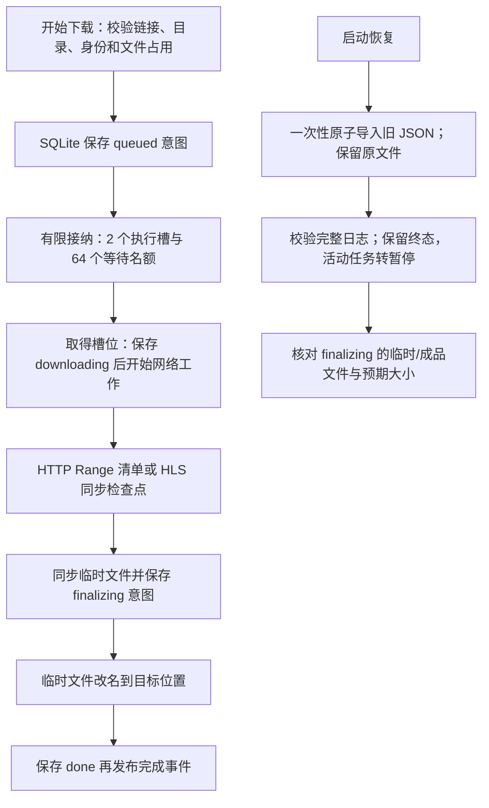

# 单机架构升级第二阶段：可靠下载任务链路

日期：2026-10-18。本文是实施记录；统一开发规范仍为根目录 AGENTS.md。前一阶段见 [正确性契约](upgrade-phase1-2026-10-18.md)，总体设计见 [架构设计稿](architecture-blueprint-2026-10-18.md)。

## 选择与范围

继续采用本地模块化单体，用已有 SQLite、消费侧小接口和应用生命周期完成下载任务升级。没有新增运行服务或依赖包，没有引入 RabbitMQ、River、Fx 或 sqlc，也没有更换 Go/Wails/Vue 的工具链。

调研的收获是借鉴持久意图、有限并发、明确所有者和故障恢复协议。当前下载的暂停、HTTP Range、HLS 加密分片和文件发布需要领域协议；通用任务库不能替代这些规则。本阶段先替换全量 JSON 快照及无界任务启动，没有做 River 对比负载实验，因此不宣称它比框架更快或已经完成框架选型实验。

工作区已有 Qorder 与之前 GPT 的大量改动。没有重置、提交或恢复已删除的 ADR。修改前相关 Go 测试通过；首批文件的原始内容与哈希保存于 `upgrade-phase2-2026-10-18/baseline/` 和 `baseline.json`。

## 实际处理链路

这里的等待名额限制当前进程内已接纳的执行尝试，不是自动领取的持久消息队列，也不承诺 FIFO。重启后等待/执行中的任务转为暂停，由用户选择继续。

## 已实施

### 持久状态与恢复

- 新增 `download.CheckpointStore` 与显式连接的 `db.DownloadTaskStore`。迁移 v12 新增下载日志及导入标记表；写入/删除针对单个任务，避免多个工作线程互相覆盖全量快照。
- 旧 `downloads.json` 在事务中全部导入或全部不导入，校验失败可见，原文件保留。导入标记避免删除后的记录被旧 JSON 复活。恢复失败时下载接口返回错误，界面显示失败原因。
- `queued/downloading` 恢复为 `paused`；`cancelled/done/error` 保留语义。恢复历史不创建 HTTP 客户端或连接池；恢复在发布 `app:ready` 前完成。
- 文件发布采用可恢复协议：先同步临时文件、保存 `finalizing`，再改名并保存完成。文件已落位但完成记录写入失败时，界面保留可用成品并提示记录失败，下一次启动核对大小后完成对账。没有把数据库和文件系统描述成同一个原子事务。

### 执行、控制与文件归属

- 新增独立 `download.Executor`，有限接纳后才创建执行尝试；每个尝试绑定应用生命周期并提供 Cancel/Done/Wait。默认同时执行 2 个下载，最多另接收 64 个等待尝试。
- 排队及开始网络前先保存对应意图；存储失败会阻止出网并返回错误。队列满有明确错误，留下可重试的任务状态。
- 暂停、取消先保存意图再停止执行，等待旧尝试清理完毕；继续下载必须等旧尝试结束。覆盖参数先校验，再取消和等待旧任务，最后处理旧文件并启动新尝试。
- 检查 URL、任务 ID 与目标路径的冲突；两个不同链接不能同时写同一目标。删除记录时保留文件与 Range 清单，旧执行的检查点不能重新插入记录，文件占用保留到该执行结束。
- 已移除记录的进度不再由后端发布，前端也对最近 256 个删除身份抑制迟到事件。删除接口对已经不存在的记录幂等成功，能清理仅在前端显示的启动失败记录。

### HLS 与直连下载

- HTTP 单连接/并行子过程只标记传输完成；统一发布过程负责文件改名和 `done`，消除提前展示完成的窗口。
- HLS 持久检查点把已经 Sync 的字节数与下一个分片编号成对保存，独立于界面进度。恢复时截去未提交尾部，全部分片已写完时直接发布，不从头重新请求。
- 旧 HLS 检查点不能证明字节数与分片编号一致。用户选择继续后，先把不可信临时文件保留为 `.part.legacy-<timestamp>` 再重新下载；导入或启动恢复阶段不清理用户文件。备份会占用磁盘，确认成品后可以手动清理。
- 保留原有 Range 校验、稀疏文件清单、AES/字节区间/初始化段和私有 Transport 关闭行为。

### 前端与迁移保障

- 下载历史读取、取消、移除失败进入现有错误展示；删除失败保留列表记录。暂停、取消、继续成功后读取后端状态，避免把实际排队或已完成状态强行改为下载中。
- 保留结构化重复下载错误，批量下载仍可按错误码识别。增加中英文各 3 个错误文案。
- Wails beta.30 重新生成 `.js` 绑定，不加 `-ts`；仍为 180 个方法。新控制方法接收注入的 context，前端参数数量保持原调用方式。
- v11→v12 测试发现旧迁移备份按秒命名，快速重试会遇到 `output file already exists`。改为独占创建唯一备份路径，失败时只清理本次不完整文件，成功快照保留原有滚动策略。

## 职责与后续扩展位置

| 位置 | 本阶段负责的行为 |
| --- | --- |
| `app/download/checkpoint.go` | 持久格式、校验、小存储接口 |
| `app/download/executor.go` | 实例级并发/等待预算、尝试生命周期 |
| `app/db/download_tasks.go` | SQLite 写入、一次性导入、启动对账 |
| `app/service/download_control.go` | 绑定适配、用户意图、去重、文件占用与执行接入 |
| `app/service/download_journal.go` | 运行态到检查点、失败反馈、恢复对象、文件发布协议 |
| `app/service/download*.go` | HTTP/HLS 传输、进度与对应断点 |

下载编排仍有部分位于 `App` 内；本阶段把持久化和调度变化点抽出，没有机械地为每个方法增加接口。后续有新的下载入口或传输时可进一步把用例所有者迁入 download 包，保持现有 Wails 入口稳定。

## 验证与限制

- 修改前 `app/download`、`app/db`、`app/service` 测试通过。
- 新增回归覆盖：排队容量/取消/拒绝、写入失败阻止出网、完成前文件落位、完成写入失败后的恢复、删除失败与迟到检查点、暂停等待后继续、目标冲突、覆盖等待/非法参数保护、HLS 已同步尾部与旧文件保留、原子导入/不复活、各恢复状态、损坏日志、关闭数据库写入、v11 数据保留、快速迁移备份重试，以及前端错误与迟到事件。
- 控制/恢复回归和覆盖回归各做重复运行，日志在阶段目录；这只能补充确定性检查，不能替代竞态检测。
- 第一轮 `scripts/verify.ps1` EXIT=0，最终完整验证也为 EXIT=0：前端 31 文件 / 160 测试、类型检查和构建通过，30 个 app Go 包通过，go vet 干净，中英文 1764/1764。日志为 `upgrade-phase2-2026-10-18/verify-final.log`，结果和产品文件哈希记录于同目录 `verification.json`。
- Windows 下 `go test -race ./app/download ./app/db ./app/service` 的程序以 `0xc0000139` 无法启动，未得到竞态检查结论。已有 Linux CI 覆盖 download/db 等包，但本轮没有运行远端 CI，也没有声称 service 在 Linux 已验证。
- 没有运行桌面界面、Android 设备、强制终止应用或真实断电测试；故障窗口通过真实 SQLite、临时文件、本地 HTTP 源站和可注入失败存储验证。大小对账不等于对抗外部进程篡改的内容校验。
- 并发预算只覆盖下载尝试，不是全应用网络/内存预算。尚未做吞吐、峰值内存和大历史量压测；不宣称下载速度提高。
- 书架/阅读进度迁 SQLite、相同冷请求合并、统一资源预算及前端工程链升级仍属后续工作。旧阅读 UI 脚本仍未作为有效验收证据。
