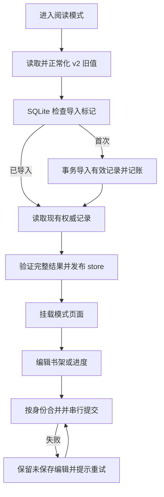

# 单机架构升级收尾：阅读数据、资源执行与工程链

开始于 2026-10-18，实施及验收延续至 2026-10-19。本文记录实现与证据，不新增开发规范。统一规范为根目录 [AGENTS.md](../AGENTS.md)；前两轮见 [第一阶段](upgrade-phase1-2026-10-18.md)、[第二阶段](upgrade-phase2-2026-10-18.md)。

## 本轮完成的范围

在本地单机、Go/Wails/Vue 模块化单体内完成：阅读个人数据迁 SQLite、备份恢复、请求取消与共享读取、核心网络预算、缓存维护、书库分页与批量读取，以及前端工具链升级。没有引入服务器、消息代理、远程节点或额外 Go 依赖。

工作区原有协作者改动保留；未提交、重置或将整棵工作区冒充本轮成果。首批文件和删除的过期脚本有修改前副本及哈希，位于 `upgrade-phase3-2026-10-18/baseline/`、`baseline.json`。本阶段原始日志没有独立保存最终退出码；后续接手结果、文件快照及环境边界见 [verification.json](upgrade-phase3-2026-10-18/verification.json)，不是补写本阶段历史通过记录。

## 一、阅读个人数据

迁移 v13 新增 `reading_state`、`reading_state_imports`。按模式、类型（shelf/progress/preferences）和自然身份保存单条记录；更新一本书的进度不重写整个书架或其他作品。

`app/readingstate` 定义格式和校验，`db.ReadingStateStore` 持有显式连接，Wails 入口负责请求上下文与公开错误映射。没有为每个数据库方法生成一套机械接口。

- 小说、漫画的 v2 浏览器旧值在每个模式首次加载时事务导入。有效数据保留快照和进度，来源已删除不作为丢弃理由。导入标记避免旧浏览器值复活已移除记录；原浏览器值不删除，也不继续双写。
- 前端沿用原领域模型和正常化规则，结构不合法的旧行不会进入有效记录；原始浏览器值仍保留供人工恢复。没有声称损坏的 JSON 可以无损自动修复。
- 初始化在路由挂载阅读页前完成；失败时不挂载页面，不允许未加载的空 store 抢先写入。壳显示失败与重试入口。
- 写入按身份串行，合并尚未提交的同一进度；迟到的旧写入不能清除更新的修改。失败不自动无限重试，待保存修改保留在内存，错误保持可见，用户重试或后续写入可继续提交。强制结束进程前尚未成功提交的修改仍可能丢失。
- 书架快照不依赖来源在线；批量校验使用自然身份，而不是本地编号碰巧相同的另一部作品。

## 二、备份和恢复闭环

完整备份格式升级为 v2，并继续读取 v1。旧客户端会拒绝 v2，避免把包含阅读数据的完整备份误当作已完全恢复。设置页说明和导入结果增加阅读记录。

- 导出包含阅读记录及其引用的作品/章节；不同库导入时按来源、远端作品/章节身份重建本地编号。
- 本机已有阅读记录优先，重复导入不覆盖当前进度。缺少目录的离线快照导出为不可用占位作品，保留原书名，不指向同编号的其他作品。
- 验证进度与章节归属；一个作品的进度不能通过备份指到另一本的章节。
- 迁移归档读取入口也包含阅读数据；旧归档没有阅读表时仍兼容。
- 脚本信任、权限和本机同意记录仍不随备份转移。

真实 SQLite 测试覆盖跨库编号碰撞、孤儿快照、局部错误回滚、本机修改保留、v1 兼容、v2 导出及归档读取。

## 三、请求链、共享工作与会话

`frontend/src/api/requestChain.ts` 拥有组合请求里的实际绑定。小说“详情 → 首次目录刷新 → 正文”、漫画“详情 → 目录 → 页表”都保留取消；第一跳之后才创建的后续请求也能取消。页面继续用 generation 防止迟到回写。

新增 `app/workflight.Group`：

- 相同表示共享一个在途读取；每个等待者独立取消，最后一个等待者离开时取消上游。
- 不把工作上下文绑在第一个调用方上。即使某个已取消的底层工作暂未退出，它仍占用接纳名额，不能通过不断取消绕过容量上限。
- 显式关闭并等待；正文、漫画页表各最多 64 个共享工作，图片最多 128 个。网络等待还有下一节的独立预算。
- 正文/页表向调用方返回副本，避免一个调用方修改共享结果。图片响应独立处理 Range/HEAD。

图片共享键包含完整请求上下文和 Cookie 会话修订；磁盘缓存继续对动态 Cookie 会话保守旁路。provider 的 Cookie 按来源身份与配置快照隔离，共享 Transport，每个 fetcher 最多保留 128 份会话。不同来源即使同域也不会共享认证 Cookie。

回归中 8 个相同图片冷请求实际只触发 1 次上游读取；8 个相同正文冷读同样只触发 1 次。另覆盖首个调用方取消、全部调用方取消、容量拒绝及会话隔离。

## 四、资源预算和关闭

新增 App 实例持有的 `app/netbudget.Budget`，接入阅读 provider、阅读图片、HLS 播放代理和下载 Transport。许可持续到响应正文读完/关闭，流式响应不会在收到响应头时提前释放名额。

默认策略：总执行 24，同主机 8，最多等待 128；非播放流量最多占总量 20、同主机 6，为播放保留总量 4/同主机 2。分支上限为 playback 12、reading 8、images 8、download 12。队列满返回明确的 unavailable 错误，等待可取消，应用退出也会取消实际网络。

诊断页增加执行中、等待中和容量拒绝计数；运行时快照还包含各分支执行量和累计等待时间。计数含义是执行许可，不等同于 TCP 连接数。

这是本轮四条核心链路的共同预算。旧采集、豆瓣和更新模块仍保留各自已有调度/客户端；没有通过修改一个进程全局客户端，宣称全应用都受 24 个许可限制。后续如需把这些兼容路径加入同一预算，应经其实际所有者注入，避免隐藏的全局服务定位器。

后台 Group.Stop 现在明确返回是否排空。未排空时 ServiceShutdown 返回错误并保持数据库打开，不再在旧工作仍可能写入时直接关库。共享读取关闭/等待也排在关库前。并不承诺不配合取消的第三方 I/O 总能在固定秒数内结束。

## 五、缓存维护

- CSS 选择器和正则编译结果各限制为 512 项，超过 8192 字节的键不驻留，编译失败也在同一有界缓存内。
- 产品中的海报、阅读图片和正文缓存淘汰由应用后台任务组拥有，单个 store 只接纳一份待执行维护。写入不再承担全目录淘汰扫描。
- 淘汰遍历检查取消；拒绝启动后释放排队标记，不留下永久“维护中”。独立小工具/单测可保留同步维护方式。

## 六、数据规模和模式注册

迁移 v14 增加按模式/编号、模式/标题的分页索引。

- `LibraryCatalogPage` 提供查询绑定的 keyset 游标。每页最多 100 条，当前视图每次 60 条；首个游标保存编号上界，翻页期间新插入的作品不挤入这轮结果。
- 标题排序使用 SQLite NOCASE 和编号作为稳定次序，最近入库使用编号倒序。标题或状态在翻页间被外部更新时，仍可能影响视图，需要重新加载；没有把多次 IPC 描述成一个数据库快照事务。
- 分类和完结筛选应用于整库，分类选项也覆盖整库。只扫描紧凑的 id/title/genres/status 投影，再读取当前页的完整元数据；不会只筛前 60 条却宣称“没有结果”。
- 小说/漫画分类页支持加载更多和失败重试；漫画发现页读取有限首页。已加载数量明确标成“已加载”，没有把它误称为总数。
- 书架自然身份批量读取每次最多 256 条，前端按 128 条切批；数据库每批最多 64 个条件。不取无关章节目录，不为一本书各发一个 Wails 请求。
- 来源作品数量改为分组查询；空来源统计的 SUM NULL 正常返回 0。
- 前端模式类型、路由前缀、壳工厂和装配遍历来自同一注册表。阅读与视频各自的业务语义仍然分开，不要求新增来源实现无关的能力。

本机基准（Windows / i5-11400H，3 次，1 万条作品、每条约 4 KB 简介）：

| 路径 | ns/op | B/op | allocs/op |
| --- | ---: | ---: | ---: |
| 旧全量读取 10000 条 | 336334300 | 52983117 | 362112 |
| 读取 60 条分页，含分类汇总 | 39944467 | 875613 | 13997 |

日志：`upgrade-phase3-2026-10-18/catalog-benchmark.log`。这是有限合成数据的数据库物化比较，不是 UI P95、网络吞吐或整机内存的生产测量；稀少分类匹配仍可能扫描许多投影行，分类汇总仍随库规模增长。

## 七、工具链与测试入口

已安装并锁定：Vite 8.3.4、plugin-vue 6.0.10、Vitest 5.0.5、vue-tsc 3.3.13、TypeScript 5.9.3、Node 类型 24.19.2。本机 Node 24.18.0；package.json 声明与 Vitest 相容的 Node 版本范围。没有顺手升级运行时 Vue、Wails 或 hls.js。

对照 [Vite 3→4](https://v4.vite.dev/guide/migration.html)、[4→5](https://v5.vite.dev/guide/migration.html)、[5→6](https://v6.vite.dev/guide/migration.html)、[6→7](https://v7.vite.dev/guide/migration.html)、[7→8](https://vite.dev/guide/migration)、[Vitest 迁移](https://vitest.dev/guide/migration/)与 [Vue language-tools 发布记录](https://github.com/vuejs/language-tools/releases)，实际调整为：

- 使用 Rolldown 配置和代码分割组；仅在生产构建把 console.log/debug 当作可移除调用，保留 warn/error。
- 明确保留原浏览器语法目标 ES2020 / Chrome87 / Edge88 / Firefox78 / Safari14；Node 构建环境升级不等于提高 WebView 运行要求，也不等于已经在这些旧浏览器实测。
- TypeScript 使用 Bundler 解析；另行检查 Vite/Vitest 的 Node 配置，构建目标 ES2022。
- `npm ci` 干净安装通过。Wails 仍为 beta.30 的 JS 绑定，最终生成 184 方法、无警告。
- 新增 `scripts/generate-bindings.ps1`：先验证 Go 服务编译，再运行生成器，把警告视为失败。beta.30 在 Go 类型错误时可能只给警告仍退出 0，不能只检查退出码。
- 删除四个依赖已下线演示作品的阅读脚本，修改前副本保留在 baseline。替换为 `scripts/test-reading-browser.py` 与专用夹具并加入 CI。

## 八、验证结果与明确限制

以下为本阶段历史验证范围，完整日志为本阶段目录的 `verify-final.log`。2026-10-19 接手后重新保存了命令、退出码、文件哈希及未通过事项，见 [验收与性能分析](upgrade-acceptance-2026-10-19.md) 和 [verification.json](upgrade-phase3-2026-10-18/verification.json)。验证使用独立数据库、临时目录和本地/模拟源。

- 完整 Go 测试、go vet、前端测试、类型检查、Node 配置检查和生产构建均纳入完整脚本。
- 真正运行的浏览器检查：设置页、播放器、阅读模式。读取的是实际 Vue 视图与 store，经确定性的 Wails 传输替身验证；其中阅读覆盖导入、分页、全库筛选、清理 localStorage 后重载、失败重试和模式隔离。
- 浏览器截图已查看，位于 `browser-reading/`。Chrome 夹具不等于桌面 Wails、Android 真机或真实内容站点。
- 真实 SQLite 测试验证迁移、事务回滚、损坏记录、断库、旧值不复活、跨库身份重建；并发/取消、预算、维护、分页和请求链另有针对性回归。
- 本轮再次尝试 Windows race，程序仍以 `0xc0000139` 无法启动；没有得到竞态结论。本机没有可用 WSL 发行版/Docker，没有为绕过测试去安装系统服务。Linux CI 已加入 netbudget/workflight/readingstate，但本轮没有运行远端 CI。

## 架构决策的完成边界

本轮没有把“框架化”解释为删除全部全局入口、给每个类型创建接口或让所有业务使用消息队列。已把新增的持久状态、执行预算、共享工作与维护任务交给明确所有者；既有 db 默认连接、视频 CMS v2 策略、采集/豆瓣调度和 Wails 平台适配保留兼容入口。新增平台或内容协议仍需要真实实现、迁移和对应环境验证。

这三轮已实现并接入新 store、分页和预算接口；历史自动检查不能替代后续修改的验收，也不能据此宣布性能优化全部完成。后续 Android/Windows 数据已收录到接手报告，仍存在原生内存留存、压力测量夹具及 race 环境限制。用户已决定自行进行真机和体验验证，后续工作聚焦性能分析。统一开发规范继续只放在 AGENTS.md。
